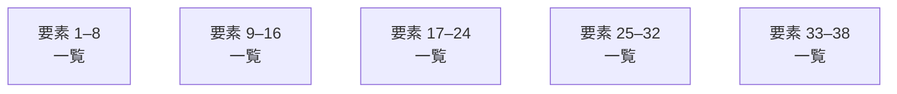

# overall-architecture

[解析トップへ戻る](../README.md)

# ollama

OllamaのGo／ネイティブ推論プロジェクト。CLI入口とサーバー関連の一部を確認しました。

この図はリポジトリ内の構成です。コードを実行した結果やサービス間の通信保証ではありません。

## 対象と根拠

対象: https://github.com/FORIFOR/ollama

取得ブランチ: `main`

Git tree SHA: `53fed26112817f7c55f664efb9e3f65f06cab7db`

ファイル一覧: 1352件。内容確認: 8件。全ファイルの意味解析ではありません。

## 解析の制約

実コードの取得は入口、マニフェスト、直接参照先を中心とする初回解析です。動的ロード、実行時設定、別リポジトリとの接続、ローカル未コミット変更は未確認です。

## 確認が必要な点

構成図の配置関係と、実際の通信・呼び出し関係を区別してください。README上の機能や精度の記述は動作検証済みという意味ではありません。

## 追加解析

未読の中核モジュールから処理順序・データ保存・状態遷移を追加解析する。実行環境で通信先と機能フラグを照合する。

## 補足

2026-10-11の初回解析スナップショットです。現在のコードとの差分や実行環境は追加確認が必要です。

## 要素の説明

### group-1

このグループは表示用の区切りです。独立した実行モジュールではありません。

[詳細な図と説明を見る](group-1/README.md)

### group-2

このグループは表示用の区切りです。独立した実行モジュールではありません。

[詳細な図と説明を見る](group-2/README.md)

### group-3

このグループは表示用の区切りです。独立した実行モジュールではありません。

[詳細な図と説明を見る](group-3/README.md)

### group-4

このグループは表示用の区切りです。独立した実行モジュールではありません。

[詳細な図と説明を見る](group-4/README.md)

### group-5

このグループは表示用の区切りです。独立した実行モジュールではありません。

[詳細な図と説明を見る](group-5/README.md)

