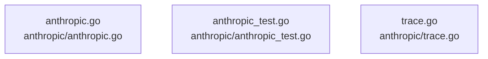

# overall-architecture/group-1/n-anthropic-c03a8d

[解析トップへ戻る](../../../README.md)

確認したパス: `anthropic`。配下の登録ファイルは3件。

- `anthropic/anthropic.go`（一覧のみ）
- `anthropic/anthropic_test.go`（一覧のみ）
- `anthropic/trace.go`（一覧のみ）

## 要素の説明

### n-anthropic-anthropic-go-be01b0

実在パス: `anthropic/anthropic.go`。1ファイル。

- `anthropic/anthropic.go`

### n-anthropic-anthropic-test-go-f697e3

実在パス: `anthropic/anthropic_test.go`。1ファイル。

- `anthropic/anthropic_test.go`

### n-anthropic-trace-go-b97055

実在パス: `anthropic/trace.go`。1ファイル。

- `anthropic/trace.go`

