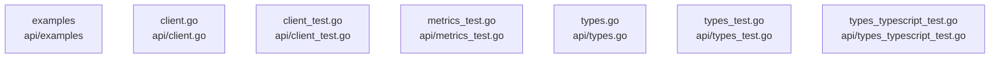

# overall-architecture/group-1/n-api-a033a5

[解析トップへ戻る](../../../README.md)

確認したパス: `api`。配下の登録ファイルは12件。

- `api/client.go`（内容確認済み）
- `api/client_test.go`（一覧のみ）
- `api/examples/README.md`（一覧のみ）
- `api/examples/chat/main.go`（一覧のみ）
- `api/examples/generate-streaming/main.go`（一覧のみ）
- `api/examples/generate/main.go`（一覧のみ）
- `api/examples/multimodal/main.go`（一覧のみ）
- `api/examples/pull-progress/main.go`（一覧のみ）
- `api/metrics_test.go`（一覧のみ）
- `api/types.go`（一覧のみ）
- `api/types_test.go`（一覧のみ）
- `api/types_typescript_test.go`（一覧のみ）

## 要素の説明

### n-api-client-go-beff4c

実在パス: `api/client.go`。1ファイル。

- `api/client.go`

### n-api-client-test-go-dfde3a

実在パス: `api/client_test.go`。1ファイル。

- `api/client_test.go`

### n-api-examples-ea78a3

実在パス: `api/examples`。6ファイル。

- `api/examples/README.md`
- `api/examples/chat/main.go`
- `api/examples/generate-streaming/main.go`
- `api/examples/generate/main.go`
- `api/examples/multimodal/main.go`
- `api/examples/pull-progress/main.go`

### n-api-metrics-test-go-c8bb90

実在パス: `api/metrics_test.go`。1ファイル。

- `api/metrics_test.go`

### n-api-types-go-c68bf6

実在パス: `api/types.go`。1ファイル。

- `api/types.go`

### n-api-types-test-go-cdb2b7

実在パス: `api/types_test.go`。1ファイル。

- `api/types_test.go`

### n-api-types-typescript-test-go-620ab8

実在パス: `api/types_typescript_test.go`。1ファイル。

- `api/types_typescript_test.go`

