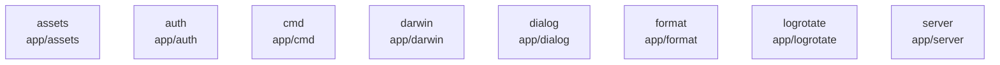

# overall-architecture/group-1/n-app-7d1043/group-1

[解析トップへ戻る](../../../../README.md)

このグループは表示用の区切りです。独立した実行モジュールではありません。

## 要素の説明

### n-app-assets-f75504

実在パス: `app/assets`。6ファイル。

- `app/assets/app.ico`
- `app/assets/assets.go`
- `app/assets/background.png`
- `app/assets/setup.bmp`
- `app/assets/tray.ico`
- `app/assets/tray_upgrade.ico`

### n-app-auth-e1441a

実在パス: `app/auth`。1ファイル。

- `app/auth/connect.go`

### n-app-cmd-3b293e

実在パス: `app/cmd`。22ファイル。

- `app/cmd/app/AppDelegate.h`
- `app/cmd/app/app.go`
- `app/cmd/app/app_darwin.go`
- `app/cmd/app/app_darwin.h`
- `app/cmd/app/app_darwin.m`
- `app/cmd/app/app_darwin_test.go`
- `app/cmd/app/app_test.go`
- `app/cmd/app/app_windows.go`
- `app/cmd/app/claude_desktop_bindings_darwin.go`
- `app/cmd/app/claude_desktop_bindings_windows.go`
- `app/cmd/app/claude_desktop_installer_darwin.go`
- `app/cmd/app/claude_desktop_installer_darwin_test.go`
- `app/cmd/app/claude_desktop_status.go`
- `app/cmd/app/codex_app_bindings_darwin.go`
- `app/cmd/app/codex_app_bindings_windows.go`
- `app/cmd/app/codex_app_darwin.go`
- `app/cmd/app/codex_app_darwin_test.go`
- `app/cmd/app/codex_desktop_installer_darwin.go`
- `app/cmd/app/codex_desktop_installer_darwin_test.go`
- `app/cmd/app/menu.h`
- `app/cmd/app/webview.go`
- `app/cmd/squirrel/Info.plist`

### n-app-darwin-08dc15

実在パス: `app/darwin`。13ファイル。

- `app/darwin/Ollama.app/Contents/Info.plist`
- `app/darwin/Ollama.app/Contents/Library/LaunchAgents/com.ollama.ollama.plist`
- `app/darwin/Ollama.app/Contents/Resources/chatgpt.svg`
- `app/darwin/Ollama.app/Contents/Resources/claude.svg`
- `app/darwin/Ollama.app/Contents/Resources/icon.icns`
- `app/darwin/Ollama.app/Contents/Resources/ollama.png`
- `app/darwin/Ollama.app/Contents/Resources/ollama@2x.png`
- `app/darwin/Ollama.app/Contents/Resources/ollamaDark.png`
- `app/darwin/Ollama.app/Contents/Resources/ollamaDark@2x.png`
- `app/darwin/Ollama.app/Contents/Resources/ollamaUpdate.png`
- `app/darwin/Ollama.app/Contents/Resources/ollamaUpdate@2x.png`
- `app/darwin/Ollama.app/Contents/Resources/ollamaUpdateDark.png`
- `app/darwin/Ollama.app/Contents/Resources/ollamaUpdateDark@2x.png`

### n-app-dialog-945b32

実在パス: `app/dialog`。8ファイル。

- `app/dialog/LICENSE`
- `app/dialog/cocoa/dlg.h`
- `app/dialog/cocoa/dlg.m`
- `app/dialog/cocoa/dlg_darwin.go`
- `app/dialog/dlgs.go`
- `app/dialog/dlgs_darwin.go`
- `app/dialog/dlgs_windows.go`
- `app/dialog/util.go`

### n-app-format-3cf4f0

実在パス: `app/format`。2ファイル。

- `app/format/field.go`
- `app/format/field_test.go`

### n-app-logrotate-ca1531

実在パス: `app/logrotate`。2ファイル。

- `app/logrotate/logrotate.go`
- `app/logrotate/logrotate_test.go`

### n-app-server-38db5f

実在パス: `app/server`。4ファイル。

- `app/server/server.go`
- `app/server/server_test.go`
- `app/server/server_unix.go`
- `app/server/server_windows.go`

