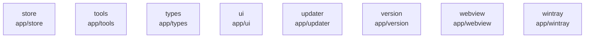

# overall-architecture/group-1/n-app-7d1043/group-2

[解析トップへ戻る](../../../../README.md)

このグループは表示用の区切りです。独立した実行モジュールではありません。

## 要素の説明

### n-app-store-8948de

実在パス: `app/store`。12ファイル。

- `app/store/cloud_config.go`
- `app/store/cloud_config_test.go`
- `app/store/database.go`
- `app/store/database_test.go`
- `app/store/image.go`
- `app/store/migration_test.go`
- `app/store/schema.sql`
- `app/store/schema_test.go`
- `app/store/store.go`
- `app/store/store_test.go`
- `app/store/test_home_test.go`
- `app/store/testdata/schema.sql`

### n-app-tools-78984f

実在パス: `app/tools`。11ファイル。

- `app/tools/browser.go`
- `app/tools/browser_crawl.go`
- `app/tools/browser_test.go`
- `app/tools/browser_websearch.go`
- `app/tools/cloud_policy.go`
- `app/tools/cloud_policy_test.go`
- `app/tools/tools.go`
- `app/tools/url_policy.go`
- `app/tools/url_policy_test.go`
- `app/tools/web_fetch.go`
- `app/tools/web_search.go`

### n-app-types-9a166d

実在パス: `app/types`。3ファイル。

- `app/types/not/found.go`
- `app/types/not/valids.go`
- `app/types/not/valids_test.go`

### n-app-ui-fd9d61

実在パス: `app/ui`。141ファイル。

- `app/ui/app.go`
- `app/ui/app/.gitignore`
- `app/ui/app/.prettierignore`
- `app/ui/app/.prettierrc`
- `app/ui/app/codegen/gotypes.gen.ts`
- `app/ui/app/eslint.config.js`
- `app/ui/app/index.html`
- `app/ui/app/package-lock.json`
- `app/ui/app/package.json`
- `app/ui/app/public/chatgpt-connected.png`
- `app/ui/app/public/claude-connected.png`
- `app/ui/app/public/hello.png`
- `app/ui/app/public/launch-icons/claude-code.svg`
- `app/ui/app/public/launch-icons/claude.svg`
- `app/ui/app/public/launch-icons/cline.svg`
- `app/ui/app/public/launch-icons/codex-color.svg`
- `app/ui/app/public/launch-icons/codex-dark.svg`
- `app/ui/app/public/launch-icons/codex.svg`
- `app/ui/app/public/launch-icons/copilot-dark.svg`
- `app/ui/app/public/launch-icons/copilot.svg`
- `app/ui/app/public/launch-icons/deepseek-harness.svg`
- `app/ui/app/public/launch-icons/droid.svg`
- `app/ui/app/public/launch-icons/hermes-agent.svg`
- `app/ui/app/public/launch-icons/oh-my-pi.svg`
- `app/ui/app/public/launch-icons/openclaw.svg`

### n-app-updater-45c761

実在パス: `app/updater`。9ファイル。

- `app/updater/updater.go`
- `app/updater/updater_darwin.go`
- `app/updater/updater_darwin.h`
- `app/updater/updater_darwin.m`
- `app/updater/updater_darwin_test.go`
- `app/updater/updater_live_test.go`
- `app/updater/updater_test.go`
- `app/updater/updater_windows.go`
- `app/updater/updater_windows_test.go`

### n-app-version-c5d523

実在パス: `app/version`。1ファイル。

- `app/version/version.go`

### n-app-webview-f73aa8

実在パス: `app/webview`。7ファイル。

- `app/webview/.gitignore`
- `app/webview/README.md`
- `app/webview/WebView2.h`
- `app/webview/glue.c`
- `app/webview/webview.cc`
- `app/webview/webview.go`
- `app/webview/webview.h`

### n-app-wintray-7cd5c8

実在パス: `app/wintray`。8ファイル。

- `app/wintray/eventloop.go`
- `app/wintray/eventloop_test.go`
- `app/wintray/menus.go`
- `app/wintray/messages.go`
- `app/wintray/notifyicon.go`
- `app/wintray/tray.go`
- `app/wintray/w32api.go`
- `app/wintray/winclass.go`

