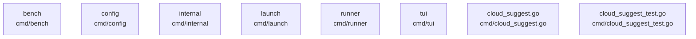

# overall-architecture/group-1/n-cmd-abac36/group-1

[解析トップへ戻る](../../../../README.md)

このグループは表示用の区切りです。独立した実行モジュールではありません。

## 要素の説明

### n-cmd-bench-fcc0ce

実在パス: `cmd/bench`。3ファイル。

- `cmd/bench/README.md`
- `cmd/bench/bench.go`
- `cmd/bench/bench_test.go`

### n-cmd-cloud-suggest-go-ae7a41

実在パス: `cmd/cloud_suggest.go`。1ファイル。

- `cmd/cloud_suggest.go`

### n-cmd-cloud-suggest-test-go-2ab9b5

実在パス: `cmd/cloud_suggest_test.go`。1ファイル。

- `cmd/cloud_suggest_test.go`

### n-cmd-config-0b5705

実在パス: `cmd/config`。3ファイル。

- `cmd/config/config.go`
- `cmd/config/config_cloud_test.go`
- `cmd/config/config_test.go`

### n-cmd-internal-d4e6d4

実在パス: `cmd/internal`。2ファイル。

- `cmd/internal/fileutil/files.go`
- `cmd/internal/fileutil/files_test.go`

### n-cmd-launch-f923d5

実在パス: `cmd/launch`。57ファイル。

- `cmd/launch/account.go`
- `cmd/launch/claude.go`
- `cmd/launch/claude_desktop.go`
- `cmd/launch/claude_desktop_test.go`
- `cmd/launch/claude_test.go`
- `cmd/launch/cline.go`
- `cmd/launch/cline_test.go`
- `cmd/launch/codex.go`
- `cmd/launch/codex_app.go`
- `cmd/launch/codex_app_profile.go`
- `cmd/launch/codex_app_test.go`
- `cmd/launch/codex_test.go`
- `cmd/launch/command_test.go`
- `cmd/launch/context_window.go`
- `cmd/launch/context_window_test.go`
- `cmd/launch/copilot.go`
- `cmd/launch/copilot_test.go`
- `cmd/launch/deepseek_harness.go`
- `cmd/launch/deepseek_harness_test.go`
- `cmd/launch/deprecated_models.go`
- `cmd/launch/deprecated_models_test.go`
- `cmd/launch/droid.go`
- `cmd/launch/droid_test.go`
- `cmd/launch/hermes.go`
- `cmd/launch/hermes_test.go`

### n-cmd-runner-5391ab

実在パス: `cmd/runner`。1ファイル。

- `cmd/runner/main.go`

### n-cmd-tui-58be67

実在パス: `cmd/tui`。9ファイル。

- `cmd/tui/confirm.go`
- `cmd/tui/confirm_test.go`
- `cmd/tui/selector.go`
- `cmd/tui/selector_test.go`
- `cmd/tui/signin.go`
- `cmd/tui/signin_test.go`
- `cmd/tui/spinner.go`
- `cmd/tui/tui.go`
- `cmd/tui/tui_test.go`

