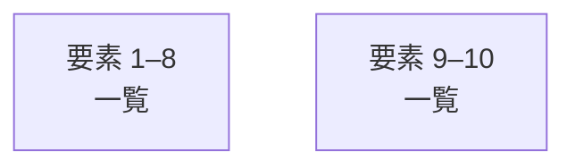

# overall-architecture/group-1/n-convert-20a70a

[解析トップへ戻る](../../../README.md)

確認したパス: `convert`。配下の登録ファイルは74件。

- `convert/convert.go`（一覧のみ）
- `convert/convert_bert.go`（一覧のみ）
- `convert/convert_commandr.go`（一覧のみ）
- `convert/convert_deepseek2.go`（一覧のみ）
- `convert/convert_deepseekocr.go`（一覧のみ）
- `convert/convert_embeddinggemma.go`（一覧のみ）
- `convert/convert_embeddinggemma_test.go`（一覧のみ）
- `convert/convert_gemma.go`（一覧のみ）
- `convert/convert_gemma2.go`（一覧のみ）
- `convert/convert_gemma2_adapter.go`（一覧のみ）
- `convert/convert_gemma3.go`（一覧のみ）
- `convert/convert_gemma3_test.go`（一覧のみ）
- `convert/convert_gemma3n.go`（一覧のみ）
- `convert/convert_gemma3n_test.go`（一覧のみ）
- `convert/convert_gemma4.go`（一覧のみ）
- `convert/convert_gemma4_test.go`（一覧のみ）
- `convert/convert_glm4moelite.go`（一覧のみ）
- `convert/convert_glm4moelite_test.go`（一覧のみ）
- `convert/convert_glmocr.go`（一覧のみ）
- `convert/convert_gptoss.go`（一覧のみ）
- `convert/convert_gptoss_test.go`（一覧のみ）
- `convert/convert_laguna.go`（一覧のみ）
- `convert/convert_laguna_test.go`（一覧のみ）
- `convert/convert_lfm2.go`（一覧のみ）
- `convert/convert_lfm2_test.go`（一覧のみ）
- `convert/convert_lfm2_vl.go`（一覧のみ）
- `convert/convert_lfm2_vl_test.go`（一覧のみ）
- `convert/convert_llama.go`（一覧のみ）
- `convert/convert_llama4.go`（一覧のみ）
- `convert/convert_llama_adapter.go`（一覧のみ）
- `convert/convert_llama_test.go`（一覧のみ）
- `convert/convert_mistral.go`（一覧のみ）
- `convert/convert_mistral_causal.go`（一覧のみ）
- `convert/convert_mistral_test.go`（一覧のみ）
- `convert/convert_mixtral.go`（一覧のみ）

## 要素の説明

### group-1

このグループは表示用の区切りです。独立した実行モジュールではありません。

[詳細な図と説明を見る](group-1/README.md)

### group-2

このグループは表示用の区切りです。独立した実行モジュールではありません。

[詳細な図と説明を見る](group-2/README.md)

