# overall-architecture/group-1/n-convert-20a70a/group-1

[解析トップへ戻る](../../../../README.md)

このグループは表示用の区切りです。独立した実行モジュールではありません。

```mermaid
graph TD
    n-convert-sentencepiece-b48550["sentencepiece\nconvert/sentencepiece"]
    n-convert-testdata-a26a2a["testdata\nconvert/testdata"]
    n-convert-convert-go-1e0605["convert.go\nconvert/convert.go"]
    n-convert-convert-bert-go-039085["convert_bert.go\nconvert/convert_bert.go"]
    n-convert-convert-commandr-go-f82cdf["convert_commandr.go\nconvert/convert_commandr.go"]
    n-convert-convert-deepseek2-go-8f1997["convert_deepseek2.go\nconvert/convert_deepseek2.go"]
    n-convert-convert-deepseekocr-go-a88c35["convert_deepseekocr.go\nconvert/convert_deepseekocr.go"]
    n-convert-convert-embeddinggemma-go-d4815c["convert_embeddinggemma.go\nconvert/convert_embeddinggemma.go"]
```

## 要素の説明

### n-convert-convert-bert-go-039085

実在パス: `convert/convert_bert.go`。1ファイル。

- `convert/convert_bert.go`

### n-convert-convert-commandr-go-f82cdf

実在パス: `convert/convert_commandr.go`。1ファイル。

- `convert/convert_commandr.go`

### n-convert-convert-deepseek2-go-8f1997

実在パス: `convert/convert_deepseek2.go`。1ファイル。

- `convert/convert_deepseek2.go`

### n-convert-convert-deepseekocr-go-a88c35

実在パス: `convert/convert_deepseekocr.go`。1ファイル。

- `convert/convert_deepseekocr.go`

### n-convert-convert-embeddinggemma-go-d4815c

実在パス: `convert/convert_embeddinggemma.go`。1ファイル。

- `convert/convert_embeddinggemma.go`

### n-convert-convert-go-1e0605

実在パス: `convert/convert.go`。1ファイル。

- `convert/convert.go`

### n-convert-sentencepiece-b48550

実在パス: `convert/sentencepiece`。1ファイル。

- `convert/sentencepiece/sentencepiece_model.pb.go`

### n-convert-testdata-a26a2a

実在パス: `convert/testdata`。11ファイル。

- `convert/testdata/Meta-Llama-3-8B-Instruct.json`
- `convert/testdata/Meta-Llama-3.1-8B-Instruct.json`
- `convert/testdata/Mistral-7B-Instruct-v0.2.json`
- `convert/testdata/Mixtral-8x7B-Instruct-v0.1.json`
- `convert/testdata/Phi-3-mini-128k-instruct.json`
- `convert/testdata/Qwen2.5-0.5B-Instruct.json`
- `convert/testdata/all-MiniLM-L6-v2.json`
- `convert/testdata/c4ai-command-r-v01.json`
- `convert/testdata/gemma-2-2b-it.json`
- `convert/testdata/gemma-2-9b-it.json`
- `convert/testdata/gemma-2b-it.json`

