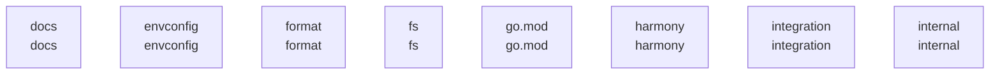

# overall-architecture/group-2

[解析トップへ戻る](../../README.md)

このグループは表示用の区切りです。独立した実行モジュールではありません。

## 要素の説明

### n-docs-71ab8b

確認したパス: `docs`。配下の登録ファイルは126件。

- `docs/README.md`（一覧のみ）
- `docs/api.md`（一覧のみ）
- `docs/api/anthropic-compatibility.mdx`（一覧のみ）
- `docs/api/authentication.mdx`（一覧のみ）
- `docs/api/errors.mdx`（一覧のみ）
- `docs/api/introduction.mdx`（一覧のみ）
- `docs/api/openai-compatibility.mdx`（一覧のみ）
- `docs/api/streaming.mdx`（一覧のみ）
- `docs/api/usage.mdx`（一覧のみ）
- `docs/capabilities/embeddings.mdx`（一覧のみ）
- `docs/capabilities/streaming.mdx`（一覧のみ）
- `docs/capabilities/structured-outputs.mdx`（一覧のみ）
- `docs/capabilities/thinking.mdx`（一覧のみ）
- `docs/capabilities/tool-calling.mdx`（一覧のみ）
- `docs/capabilities/vision.mdx`（一覧のみ）
- `docs/capabilities/web-search.mdx`（一覧のみ）
- `docs/cli.mdx`（一覧のみ）
- `docs/cloud.mdx`（一覧のみ）
- `docs/context-length.mdx`（一覧のみ）
- `docs/development.md`（一覧のみ）
- `docs/docker.mdx`（一覧のみ）
- `docs/docs.json`（一覧のみ）
- `docs/examples.md`（一覧のみ）
- `docs/faq.mdx`（一覧のみ）
- `docs/favicon-dark.svg`（一覧のみ）
- `docs/favicon.svg`（一覧のみ）
- `docs/gpu.mdx`（一覧のみ）
- `docs/images/claude-code-kimi-k2-6.png`（一覧のみ）
- `docs/images/claude-cowork-kimi-k2-6.png`（一覧のみ）
- `docs/images/cline-cli.png`（一覧のみ）
- `docs/images/cline-kanban.png`（一覧のみ）
- `docs/images/cline-mcp.png`（一覧のみ）
- `docs/images/cline-settings.png`（一覧のみ）
- `docs/images/codex-app-annotate.png`（一覧のみ）
- `docs/images/codex-app-home.png`（一覧のみ）

[詳細な図と説明を見る](n-docs-71ab8b/README.md)

### n-envconfig-d4eb1a

確認したパス: `envconfig`。配下の登録ファイルは3件。

- `envconfig/config.go`（一覧のみ）
- `envconfig/config_test.go`（一覧のみ）
- `envconfig/test_home_test.go`（一覧のみ）

[詳細な図と説明を見る](n-envconfig-d4eb1a/README.md)

### n-format-785987

確認したパス: `format`。配下の登録ファイルは6件。

- `format/bytes.go`（一覧のみ）
- `format/bytes_test.go`（一覧のみ）
- `format/format.go`（一覧のみ）
- `format/format_test.go`（一覧のみ）
- `format/time.go`（一覧のみ）
- `format/time_test.go`（一覧のみ）

[詳細な図と説明を見る](n-format-785987/README.md)

### n-fs-3f4bb5

確認したパス: `fs`。配下の登録ファイルは17件。

- `fs/config.go`（一覧のみ）
- `fs/ggml/ggml.go`（一覧のみ）
- `fs/ggml/ggml_test.go`（一覧のみ）
- `fs/ggml/gguf.go`（一覧のみ）
- `fs/ggml/gguf_test.go`（一覧のみ）
- `fs/ggml/type.go`（一覧のみ）
- `fs/ggml/type_test.go`（一覧のみ）
- `fs/gguf/gguf.go`（一覧のみ）
- `fs/gguf/gguf_internal_test.go`（一覧のみ）
- `fs/gguf/gguf_test.go`（一覧のみ）
- `fs/gguf/keyvalue.go`（一覧のみ）
- `fs/gguf/keyvalue_test.go`（一覧のみ）
- `fs/gguf/lazy.go`（一覧のみ）
- `fs/gguf/reader.go`（一覧のみ）
- `fs/gguf/tensor.go`（一覧のみ）
- `fs/util/bufioutil/buffer_seeker.go`（一覧のみ）
- `fs/util/bufioutil/buffer_seeker_test.go`（一覧のみ）

[詳細な図と説明を見る](n-fs-3f4bb5/README.md)

### n-go-mod-c47645

確認したパス: `go.mod`。配下の登録ファイルは1件。

- `go.mod`（内容確認済み）

### n-harmony-5343a7

確認したパス: `harmony`。配下の登録ファイルは2件。

- `harmony/harmonyparser.go`（一覧のみ）
- `harmony/harmonyparser_test.go`（一覧のみ）

[詳細な図と説明を見る](n-harmony-5343a7/README.md)

### n-integration-06eff5

確認したパス: `integration`。配下の登録ファイルは32件。

- `integration/README.md`（一覧のみ）
- `integration/api_test.go`（一覧のみ）
- `integration/audio_test.go`（一覧のみ）
- `integration/audio_test_data_test.go`（一覧のみ）
- `integration/basic_test.go`（一覧のみ）
- `integration/chat_cases_test.go`（一覧のみ）
- `integration/concurrency_test.go`（一覧のみ）
- `integration/context_test.go`（一覧のみ）
- `integration/create_test.go`（一覧のみ）
- `integration/embed_cases_test.go`（一覧のみ）
- `integration/embed_test.go`（一覧のみ）
- `integration/generate_jinja_test.go`（一覧のみ）
- `integration/llm_image_test.go`（一覧のみ）
- `integration/max_queue_test.go`（一覧のみ）
- `integration/quantization_test.go`（一覧のみ）
- `integration/reg_fast_test.go`（一覧のみ）
- `integration/reg_groups_test.go`（一覧のみ）
- `integration/reg_library_test.go`（一覧のみ）
- `integration/reg_release_test.go`（一覧のみ）
- `integration/reg_required_test.go`（一覧のみ）
- `integration/reg_test.go`（一覧のみ）
- `integration/structured_output_test.go`（一覧のみ）
- `integration/testdata/embed.json`（一覧のみ）
- `integration/testdata/shakespeare.txt`（一覧のみ）
- `integration/thinking_test.go`（一覧のみ）
- `integration/tools_routes_test.go`（一覧のみ）
- `integration/tools_stress_test.go`（一覧のみ）
- `integration/tools_test.go`（一覧のみ）
- `integration/utils_test.go`（一覧のみ）
- `integration/vision_ocr_test.go`（一覧のみ）
- `integration/vision_test.go`（一覧のみ）
- `integration/vision_test_data_test.go`（一覧のみ）

[詳細な図と説明を見る](n-integration-06eff5/README.md)

### n-internal-9f33a7

確認したパス: `internal`。配下の登録ファイルは20件。

- `internal/cloud/policy.go`（一覧のみ）
- `internal/cloud/policy_test.go`（一覧のみ）
- `internal/cloud/test_home_test.go`（一覧のみ）
- `internal/modelref/modelref.go`（一覧のみ）
- `internal/modelref/modelref_test.go`（一覧のみ）
- `internal/orderedmap/orderedmap.go`（一覧のみ）
- `internal/orderedmap/orderedmap_test.go`（一覧のみ）
- `internal/proxy/claude_desktop.go`（一覧のみ）
- `internal/proxy/claude_desktop_access.go`（一覧のみ）
- `internal/proxy/claude_desktop_access_test.go`（一覧のみ）
- `internal/proxy/claude_desktop_models.go`（一覧のみ）
- `internal/proxy/claude_desktop_models_test.go`（一覧のみ）
- `internal/proxy/claude_desktop_test.go`（一覧のみ）
- `internal/proxy/codex_desktop.go`（一覧のみ）
- `internal/proxy/codex_desktop_agents_test.go`（一覧のみ）
- `internal/proxy/codex_desktop_autoreview.go`（一覧のみ）
- `internal/proxy/codex_desktop_errors.go`（一覧のみ）
- `internal/proxy/codex_desktop_errors_test.go`（一覧のみ）
- `internal/proxy/codex_desktop_normalize.go`（一覧のみ）
- `internal/proxy/codex_desktop_test.go`（一覧のみ）

[詳細な図と説明を見る](n-internal-9f33a7/README.md)

