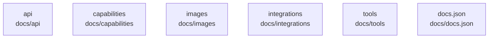

# overall-architecture/group-2/n-docs-71ab8b

[解析トップへ戻る](../../../README.md)

確認したパス: `docs`。配下の登録ファイルは126件。

- `docs/README.md`（一覧のみ）
- `docs/api.md`（一覧のみ）
- `docs/api/anthropic-compatibility.mdx`（一覧のみ）
- `docs/api/authentication.mdx`（一覧のみ）
- `docs/api/errors.mdx`（一覧のみ）
- `docs/api/introduction.mdx`（一覧のみ）
- `docs/api/openai-compatibility.mdx`（一覧のみ）
- `docs/api/streaming.mdx`（一覧のみ）
- `docs/api/usage.mdx`（一覧のみ）
- `docs/capabilities/embeddings.mdx`（一覧のみ）
- `docs/capabilities/streaming.mdx`（一覧のみ）
- `docs/capabilities/structured-outputs.mdx`（一覧のみ）
- `docs/capabilities/thinking.mdx`（一覧のみ）
- `docs/capabilities/tool-calling.mdx`（一覧のみ）
- `docs/capabilities/vision.mdx`（一覧のみ）
- `docs/capabilities/web-search.mdx`（一覧のみ）
- `docs/cli.mdx`（一覧のみ）
- `docs/cloud.mdx`（一覧のみ）
- `docs/context-length.mdx`（一覧のみ）
- `docs/development.md`（一覧のみ）
- `docs/docker.mdx`（一覧のみ）
- `docs/docs.json`（一覧のみ）
- `docs/examples.md`（一覧のみ）
- `docs/faq.mdx`（一覧のみ）
- `docs/favicon-dark.svg`（一覧のみ）
- `docs/favicon.svg`（一覧のみ）
- `docs/gpu.mdx`（一覧のみ）
- `docs/images/claude-code-kimi-k2-6.png`（一覧のみ）
- `docs/images/claude-cowork-kimi-k2-6.png`（一覧のみ）
- `docs/images/cline-cli.png`（一覧のみ）
- `docs/images/cline-kanban.png`（一覧のみ）
- `docs/images/cline-mcp.png`（一覧のみ）
- `docs/images/cline-settings.png`（一覧のみ）
- `docs/images/codex-app-annotate.png`（一覧のみ）
- `docs/images/codex-app-home.png`（一覧のみ）

## 要素の説明

### n-docs-api-c63ff3

実在パス: `docs/api`。7ファイル。

- `docs/api/anthropic-compatibility.mdx`
- `docs/api/authentication.mdx`
- `docs/api/errors.mdx`
- `docs/api/introduction.mdx`
- `docs/api/openai-compatibility.mdx`
- `docs/api/streaming.mdx`
- `docs/api/usage.mdx`

### n-docs-capabilities-1b8d66

実在パス: `docs/capabilities`。7ファイル。

- `docs/capabilities/embeddings.mdx`
- `docs/capabilities/streaming.mdx`
- `docs/capabilities/structured-outputs.mdx`
- `docs/capabilities/thinking.mdx`
- `docs/capabilities/tool-calling.mdx`
- `docs/capabilities/vision.mdx`
- `docs/capabilities/web-search.mdx`

### n-docs-docs-json-515c87

実在パス: `docs/docs.json`。1ファイル。

- `docs/docs.json`

### n-docs-images-9a911f

実在パス: `docs/images`。56ファイル。

- `docs/images/claude-code-kimi-k2-6.png`
- `docs/images/claude-cowork-kimi-k2-6.png`
- `docs/images/cline-cli.png`
- `docs/images/cline-kanban.png`
- `docs/images/cline-mcp.png`
- `docs/images/cline-settings.png`
- `docs/images/codex-app-annotate.png`
- `docs/images/codex-app-home.png`
- `docs/images/codex-app-review.png`
- `docs/images/codex-mcp.png`
- `docs/images/favicon.png`
- `docs/images/goose-cli.png`
- `docs/images/goose-mcp-1.png`
- `docs/images/goose-mcp-2.png`
- `docs/images/goose-settings.png`
- `docs/images/hermes.png`
- `docs/images/intellij-chat-sidebar.png`
- `docs/images/intellij-current-model.png`
- `docs/images/intellij-local-models.png`
- `docs/images/launch-icons/claude-code.svg`
- `docs/images/launch-icons/deepseek-harness.svg`
- `docs/images/launch-icons/hermes-agent.svg`
- `docs/images/launch-icons/openclaw.svg`
- `docs/images/launch-icons/opencode.svg`
- `docs/images/launch-icons/vscode.svg`

### n-docs-integrations-dfe281

実在パス: `docs/integrations`。27ファイル。

- `docs/integrations/claude-code.mdx`
- `docs/integrations/claude-desktop.mdx`
- `docs/integrations/cline-cli.mdx`
- `docs/integrations/cline.mdx`
- `docs/integrations/codex-app.mdx`
- `docs/integrations/codex.mdx`
- `docs/integrations/copilot-cli.mdx`
- `docs/integrations/deepseek-harness.mdx`
- `docs/integrations/droid.mdx`
- `docs/integrations/goose.mdx`
- `docs/integrations/hermes-desktop.mdx`
- `docs/integrations/hermes.mdx`
- `docs/integrations/index.mdx`
- `docs/integrations/jetbrains.mdx`
- `docs/integrations/marimo.mdx`
- `docs/integrations/n8n.mdx`
- `docs/integrations/nemoclaw.mdx`
- `docs/integrations/oh-my-pi.mdx`
- `docs/integrations/onyx.mdx`
- `docs/integrations/openclaw.mdx`
- `docs/integrations/opencode.mdx`
- `docs/integrations/pi.mdx`
- `docs/integrations/pool.mdx`
- `docs/integrations/roo-code.mdx`
- `docs/integrations/vscode.mdx`

### n-docs-tools-57bc40

実在パス: `docs/tools`。2ファイル。

- `docs/tools/extract-examples/README.md`
- `docs/tools/extract-examples/main.go`

