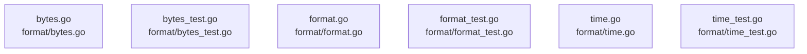

# overall-architecture/group-2/n-format-785987

[解析トップへ戻る](../../../README.md)

確認したパス: `format`。配下の登録ファイルは6件。

- `format/bytes.go`（一覧のみ）
- `format/bytes_test.go`（一覧のみ）
- `format/format.go`（一覧のみ）
- `format/format_test.go`（一覧のみ）
- `format/time.go`（一覧のみ）
- `format/time_test.go`（一覧のみ）

## 要素の説明

### n-format-bytes-go-c757d2

実在パス: `format/bytes.go`。1ファイル。

- `format/bytes.go`

### n-format-bytes-test-go-da8558

実在パス: `format/bytes_test.go`。1ファイル。

- `format/bytes_test.go`

### n-format-format-go-4d75e2

実在パス: `format/format.go`。1ファイル。

- `format/format.go`

### n-format-format-test-go-2509e4

実在パス: `format/format_test.go`。1ファイル。

- `format/format_test.go`

### n-format-time-go-cbbcb5

実在パス: `format/time.go`。1ファイル。

- `format/time.go`

### n-format-time-test-go-3be785

実在パス: `format/time_test.go`。1ファイル。

- `format/time_test.go`

