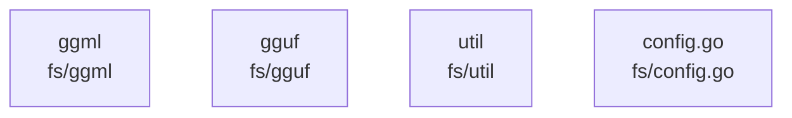

# overall-architecture/group-2/n-fs-3f4bb5

[解析トップへ戻る](../../../README.md)

確認したパス: `fs`。配下の登録ファイルは17件。

- `fs/config.go`（一覧のみ）
- `fs/ggml/ggml.go`（一覧のみ）
- `fs/ggml/ggml_test.go`（一覧のみ）
- `fs/ggml/gguf.go`（一覧のみ）
- `fs/ggml/gguf_test.go`（一覧のみ）
- `fs/ggml/type.go`（一覧のみ）
- `fs/ggml/type_test.go`（一覧のみ）
- `fs/gguf/gguf.go`（一覧のみ）
- `fs/gguf/gguf_internal_test.go`（一覧のみ）
- `fs/gguf/gguf_test.go`（一覧のみ）
- `fs/gguf/keyvalue.go`（一覧のみ）
- `fs/gguf/keyvalue_test.go`（一覧のみ）
- `fs/gguf/lazy.go`（一覧のみ）
- `fs/gguf/reader.go`（一覧のみ）
- `fs/gguf/tensor.go`（一覧のみ）
- `fs/util/bufioutil/buffer_seeker.go`（一覧のみ）
- `fs/util/bufioutil/buffer_seeker_test.go`（一覧のみ）

## 要素の説明

### n-fs-config-go-daccdc

実在パス: `fs/config.go`。1ファイル。

- `fs/config.go`

### n-fs-ggml-a7d223

実在パス: `fs/ggml`。6ファイル。

- `fs/ggml/ggml.go`
- `fs/ggml/ggml_test.go`
- `fs/ggml/gguf.go`
- `fs/ggml/gguf_test.go`
- `fs/ggml/type.go`
- `fs/ggml/type_test.go`

### n-fs-gguf-0c13fd

実在パス: `fs/gguf`。8ファイル。

- `fs/gguf/gguf.go`
- `fs/gguf/gguf_internal_test.go`
- `fs/gguf/gguf_test.go`
- `fs/gguf/keyvalue.go`
- `fs/gguf/keyvalue_test.go`
- `fs/gguf/lazy.go`
- `fs/gguf/reader.go`
- `fs/gguf/tensor.go`

### n-fs-util-26a995

実在パス: `fs/util`。2ファイル。

- `fs/util/bufioutil/buffer_seeker.go`
- `fs/util/bufioutil/buffer_seeker_test.go`

