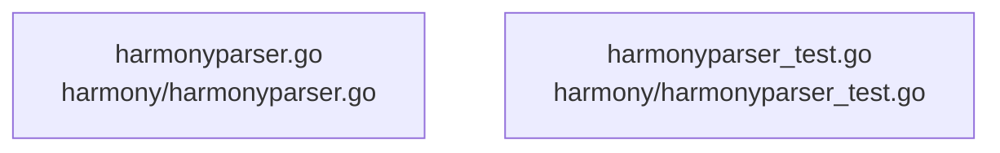

# overall-architecture/group-2/n-harmony-5343a7

[解析トップへ戻る](../../../README.md)

確認したパス: `harmony`。配下の登録ファイルは2件。

- `harmony/harmonyparser.go`（一覧のみ）
- `harmony/harmonyparser_test.go`（一覧のみ）

## 要素の説明

### n-harmony-harmonyparser-go-6dd369

実在パス: `harmony/harmonyparser.go`。1ファイル。

- `harmony/harmonyparser.go`

### n-harmony-harmonyparser-test-go-4d3106

実在パス: `harmony/harmonyparser_test.go`。1ファイル。

- `harmony/harmonyparser_test.go`

