# overall-architecture/group-2/n-integration-06eff5/group-1

[解析トップへ戻る](../../../../README.md)

このグループは表示用の区切りです。独立した実行モジュールではありません。

```mermaid
graph TD
    n-integration-testdata-dfe4e3["testdata\nintegration/testdata"]
    n-integration-api-test-go-3b85fc["api_test.go\nintegration/api_test.go"]
    n-integration-audio-test-go-5782ea["audio_test.go\nintegration/audio_test.go"]
    n-integration-audio-test-data-test-go-2fb8b2["audio_test_data_test.go\nintegration/audio_test_data_test.go"]
    n-integration-basic-test-go-46f2d9["basic_test.go\nintegration/basic_test.go"]
    n-integration-chat-cases-test-go-8eac05["chat_cases_test.go\nintegration/chat_cases_test.go"]
    n-integration-concurrency-test-go-f6672e["concurrency_test.go\nintegration/concurrency_test.go"]
    n-integration-context-test-go-2b188d["context_test.go\nintegration/context_test.go"]
```

## 要素の説明

### n-integration-api-test-go-3b85fc

実在パス: `integration/api_test.go`。1ファイル。

- `integration/api_test.go`

### n-integration-audio-test-data-test-go-2fb8b2

実在パス: `integration/audio_test_data_test.go`。1ファイル。

- `integration/audio_test_data_test.go`

### n-integration-audio-test-go-5782ea

実在パス: `integration/audio_test.go`。1ファイル。

- `integration/audio_test.go`

### n-integration-basic-test-go-46f2d9

実在パス: `integration/basic_test.go`。1ファイル。

- `integration/basic_test.go`

### n-integration-chat-cases-test-go-8eac05

実在パス: `integration/chat_cases_test.go`。1ファイル。

- `integration/chat_cases_test.go`

### n-integration-concurrency-test-go-f6672e

実在パス: `integration/concurrency_test.go`。1ファイル。

- `integration/concurrency_test.go`

### n-integration-context-test-go-2b188d

実在パス: `integration/context_test.go`。1ファイル。

- `integration/context_test.go`

### n-integration-testdata-dfe4e3

実在パス: `integration/testdata`。2ファイル。

- `integration/testdata/embed.json`
- `integration/testdata/shakespeare.txt`

