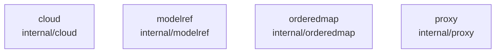

# overall-architecture/group-2/n-internal-9f33a7

[解析トップへ戻る](../../../README.md)

確認したパス: `internal`。配下の登録ファイルは20件。

- `internal/cloud/policy.go`（一覧のみ）
- `internal/cloud/policy_test.go`（一覧のみ）
- `internal/cloud/test_home_test.go`（一覧のみ）
- `internal/modelref/modelref.go`（一覧のみ）
- `internal/modelref/modelref_test.go`（一覧のみ）
- `internal/orderedmap/orderedmap.go`（一覧のみ）
- `internal/orderedmap/orderedmap_test.go`（一覧のみ）
- `internal/proxy/claude_desktop.go`（一覧のみ）
- `internal/proxy/claude_desktop_access.go`（一覧のみ）
- `internal/proxy/claude_desktop_access_test.go`（一覧のみ）
- `internal/proxy/claude_desktop_models.go`（一覧のみ）
- `internal/proxy/claude_desktop_models_test.go`（一覧のみ）
- `internal/proxy/claude_desktop_test.go`（一覧のみ）
- `internal/proxy/codex_desktop.go`（一覧のみ）
- `internal/proxy/codex_desktop_agents_test.go`（一覧のみ）
- `internal/proxy/codex_desktop_autoreview.go`（一覧のみ）
- `internal/proxy/codex_desktop_errors.go`（一覧のみ）
- `internal/proxy/codex_desktop_errors_test.go`（一覧のみ）
- `internal/proxy/codex_desktop_normalize.go`（一覧のみ）
- `internal/proxy/codex_desktop_test.go`（一覧のみ）

## 要素の説明

### n-internal-cloud-002a36

実在パス: `internal/cloud`。3ファイル。

- `internal/cloud/policy.go`
- `internal/cloud/policy_test.go`
- `internal/cloud/test_home_test.go`

### n-internal-modelref-c41363

実在パス: `internal/modelref`。2ファイル。

- `internal/modelref/modelref.go`
- `internal/modelref/modelref_test.go`

### n-internal-orderedmap-f2502c

実在パス: `internal/orderedmap`。2ファイル。

- `internal/orderedmap/orderedmap.go`
- `internal/orderedmap/orderedmap_test.go`

### n-internal-proxy-8752d0

実在パス: `internal/proxy`。13ファイル。

- `internal/proxy/claude_desktop.go`
- `internal/proxy/claude_desktop_access.go`
- `internal/proxy/claude_desktop_access_test.go`
- `internal/proxy/claude_desktop_models.go`
- `internal/proxy/claude_desktop_models_test.go`
- `internal/proxy/claude_desktop_test.go`
- `internal/proxy/codex_desktop.go`
- `internal/proxy/codex_desktop_agents_test.go`
- `internal/proxy/codex_desktop_autoreview.go`
- `internal/proxy/codex_desktop_errors.go`
- `internal/proxy/codex_desktop_errors_test.go`
- `internal/proxy/codex_desktop_normalize.go`
- `internal/proxy/codex_desktop_test.go`

