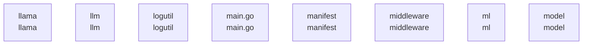

# overall-architecture/group-3

[解析トップへ戻る](../../README.md)

このグループは表示用の区切りです。独立した実行モジュールではありません。

## 要素の説明

### n-llama-ad4ba4

確認したパス: `llama`。配下の登録ファイルは12件。

- `llama/.gitignore`（一覧のみ）
- `llama/README.md`（一覧のみ）
- `llama/compat/001-llama-cpp-hooks.patch`（一覧のみ）
- `llama/compat/README.md`（一覧のみ）
- `llama/compat/compat.cmake`（一覧のみ）
- `llama/compat/llama-ollama-compat-util.cpp`（一覧のみ）
- `llama/compat/llama-ollama-compat-util.h`（一覧のみ）
- `llama/compat/llama-ollama-compat.cpp`（一覧のみ）
- `llama/compat/llama-ollama-compat.h`（一覧のみ）
- `llama/compat/models/003-llama-cpp-laguna-metal.patch`（一覧のみ）
- `llama/server/CMakeLists.txt`（一覧のみ）
- `llama/server/CMakePresets.json`（一覧のみ）

[詳細な図と説明を見る](n-llama-ad4ba4/README.md)

### n-llm-4cddc0

確認したパス: `llm`。配下の登録ファイルは19件。

- `llm/exit_status.go`（一覧のみ）
- `llm/exit_status_other.go`（一覧のみ）
- `llm/exit_status_windows.go`（一覧のみ）
- `llm/llama_binary.go`（一覧のみ）
- `llm/llama_binary_test.go`（一覧のみ）
- `llm/llama_server.go`（一覧のみ）
- `llm/llama_server_test.go`（一覧のみ）
- `llm/llm_darwin.go`（一覧のみ）
- `llm/llm_linux.go`（一覧のみ）
- `llm/llm_windows.go`（一覧のみ）
- `llm/media.go`（一覧のみ）
- `llm/metal_retry.go`（一覧のみ）
- `llm/rocm_default.go`（一覧のみ）
- `llm/rocm_windows.go`（一覧のみ）
- `llm/server.go`（内容確認済み）
- `llm/server_wait_test.go`（一覧のみ）
- `llm/status.go`（一覧のみ）
- `llm/status_test.go`（一覧のみ）
- `llm/vulkan_windows.go`（一覧のみ）

[詳細な図と説明を見る](n-llm-4cddc0/README.md)

### n-logutil-41f4e6

確認したパス: `logutil`。配下の登録ファイルは2件。

- `logutil/logutil.go`（一覧のみ）
- `logutil/logutil_test.go`（一覧のみ）

[詳細な図と説明を見る](n-logutil-41f4e6/README.md)

### n-main-go-0607f7

確認したパス: `main.go`。配下の登録ファイルは1件。

- `main.go`（内容確認済み）

### n-manifest-c5beef

確認したパス: `manifest`。配下の登録ファイルは4件。

- `manifest/layer.go`（一覧のみ）
- `manifest/manifest.go`（一覧のみ）
- `manifest/manifest_test.go`（一覧のみ）
- `manifest/paths.go`（一覧のみ）

[詳細な図と説明を見る](n-manifest-c5beef/README.md)

### n-middleware-9460a5

確認したパス: `middleware`。配下の登録ファイルは11件。

- `middleware/anthropic.go`（一覧のみ）
- `middleware/anthropic_test.go`（一覧のみ）
- `middleware/metrics.go`（一覧のみ）
- `middleware/openai.go`（一覧のみ）
- `middleware/openai_encoding_format_test.go`（一覧のみ）
- `middleware/openai_test.go`（一覧のみ）
- `middleware/responses_tool_search_test.go`（一覧のみ）
- `middleware/responses_web_search_test.go`（一覧のみ）
- `middleware/test_home_test.go`（一覧のみ）
- `middleware/web_search.go`（一覧のみ）
- `middleware/web_search_test.go`（一覧のみ）

[詳細な図と説明を見る](n-middleware-9460a5/README.md)

### n-ml-b331fc

確認したパス: `ml`。配下の登録ファイルは6件。

- `ml/backend.go`（一覧のみ）
- `ml/backend/ggml/ggml/src/ggml-cuda/template-instances/fattn-tile-instance-dkq512-dv512.cu`（一覧のみ）
- `ml/device.go`（一覧のみ）
- `ml/device_test.go`（一覧のみ）
- `ml/path.go`（一覧のみ）
- `ml/path_test.go`（一覧のみ）

[詳細な図と説明を見る](n-ml-b331fc/README.md)

### n-model-1d06a0

確認したパス: `model`。配下の登録ファイルは100件。

- `model/parsers/cogito.go`（一覧のみ）
- `model/parsers/cogito_test.go`（一覧のみ）
- `model/parsers/cohere.go`（一覧のみ）
- `model/parsers/cohere_test.go`（一覧のみ）
- `model/parsers/deepseek3.go`（一覧のみ）
- `model/parsers/deepseek3_test.go`（一覧のみ）
- `model/parsers/functiongemma.go`（一覧のみ）
- `model/parsers/functiongemma_test.go`（一覧のみ）
- `model/parsers/gemma4.go`（一覧のみ）
- `model/parsers/gemma4_test.go`（一覧のみ）
- `model/parsers/glimmer.go`（一覧のみ）
- `model/parsers/glimmer_test.go`（一覧のみ）
- `model/parsers/glm46.go`（一覧のみ）
- `model/parsers/glm46_test.go`（一覧のみ）
- `model/parsers/glm47.go`（一覧のみ）
- `model/parsers/glm47_test.go`（一覧のみ）
- `model/parsers/glmocr.go`（一覧のみ）
- `model/parsers/laguna.go`（一覧のみ）
- `model/parsers/laguna_test.go`（一覧のみ）
- `model/parsers/lfm2.go`（一覧のみ）
- `model/parsers/lfm2_test.go`（一覧のみ）
- `model/parsers/ministral.go`（一覧のみ）
- `model/parsers/ministral_test.go`（一覧のみ）
- `model/parsers/nemotron3nano.go`（一覧のみ）
- `model/parsers/nemotron3nano_test.go`（一覧のみ）
- `model/parsers/olmo3.go`（一覧のみ）
- `model/parsers/olmo3_test.go`（一覧のみ）
- `model/parsers/olmo3_think.go`（一覧のみ）
- `model/parsers/olmo3_think_test.go`（一覧のみ）
- `model/parsers/parsers.go`（一覧のみ）
- `model/parsers/parsers_test.go`（一覧のみ）
- `model/parsers/qwen3.go`（一覧のみ）
- `model/parsers/qwen35.go`（一覧のみ）
- `model/parsers/qwen35_test.go`（一覧のみ）
- `model/parsers/qwen38_test.go`（一覧のみ）

[詳細な図と説明を見る](n-model-1d06a0/README.md)

