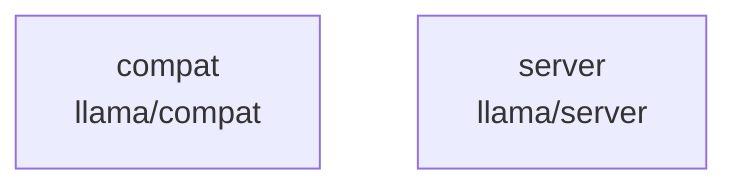

# overall-architecture/group-3/n-llama-ad4ba4

[解析トップへ戻る](../../../README.md)

確認したパス: `llama`。配下の登録ファイルは12件。

- `llama/.gitignore`（一覧のみ）
- `llama/README.md`（一覧のみ）
- `llama/compat/001-llama-cpp-hooks.patch`（一覧のみ）
- `llama/compat/README.md`（一覧のみ）
- `llama/compat/compat.cmake`（一覧のみ）
- `llama/compat/llama-ollama-compat-util.cpp`（一覧のみ）
- `llama/compat/llama-ollama-compat-util.h`（一覧のみ）
- `llama/compat/llama-ollama-compat.cpp`（一覧のみ）
- `llama/compat/llama-ollama-compat.h`（一覧のみ）
- `llama/compat/models/003-llama-cpp-laguna-metal.patch`（一覧のみ）
- `llama/server/CMakeLists.txt`（一覧のみ）
- `llama/server/CMakePresets.json`（一覧のみ）

## 要素の説明

### n-llama-compat-f39507

実在パス: `llama/compat`。8ファイル。

- `llama/compat/001-llama-cpp-hooks.patch`
- `llama/compat/README.md`
- `llama/compat/compat.cmake`
- `llama/compat/llama-ollama-compat-util.cpp`
- `llama/compat/llama-ollama-compat-util.h`
- `llama/compat/llama-ollama-compat.cpp`
- `llama/compat/llama-ollama-compat.h`
- `llama/compat/models/003-llama-cpp-laguna-metal.patch`

### n-llama-server-0250b1

実在パス: `llama/server`。2ファイル。

- `llama/server/CMakeLists.txt`
- `llama/server/CMakePresets.json`

