# overall-architecture/group-3/n-llm-4cddc0

[解析トップへ戻る](../../../README.md)

確認したパス: `llm`。配下の登録ファイルは19件。

- `llm/exit_status.go`（一覧のみ）
- `llm/exit_status_other.go`（一覧のみ）
- `llm/exit_status_windows.go`（一覧のみ）
- `llm/llama_binary.go`（一覧のみ）
- `llm/llama_binary_test.go`（一覧のみ）
- `llm/llama_server.go`（一覧のみ）
- `llm/llama_server_test.go`（一覧のみ）
- `llm/llm_darwin.go`（一覧のみ）
- `llm/llm_linux.go`（一覧のみ）
- `llm/llm_windows.go`（一覧のみ）
- `llm/media.go`（一覧のみ）
- `llm/metal_retry.go`（一覧のみ）
- `llm/rocm_default.go`（一覧のみ）
- `llm/rocm_windows.go`（一覧のみ）
- `llm/server.go`（内容確認済み）
- `llm/server_wait_test.go`（一覧のみ）
- `llm/status.go`（一覧のみ）
- `llm/status_test.go`（一覧のみ）
- `llm/vulkan_windows.go`（一覧のみ）

```mermaid
graph TD
    n-llm-exit-status-go-6547d7["exit_status.go\nllm/exit_status.go"]
    n-llm-exit-status-other-go-ae46dd["exit_status_other.go\nllm/exit_status_other.go"]
    n-llm-exit-status-windows-go-638483["exit_status_windows.go\nllm/exit_status_windows.go"]
    n-llm-llama-binary-go-fd67bc["llama_binary.go\nllm/llama_binary.go"]
    n-llm-llama-binary-test-go-96003e["llama_binary_test.go\nllm/llama_binary_test.go"]
    n-llm-llama-server-go-ff4b7c["llama_server.go\nllm/llama_server.go"]
    n-llm-llama-server-test-go-6e5798["llama_server_test.go\nllm/llama_server_test.go"]
    n-llm-llm-darwin-go-4613b9["llm_darwin.go\nllm/llm_darwin.go"]
```

## 要素の説明

### n-llm-exit-status-go-6547d7

実在パス: `llm/exit_status.go`。1ファイル。

- `llm/exit_status.go`

### n-llm-exit-status-other-go-ae46dd

実在パス: `llm/exit_status_other.go`。1ファイル。

- `llm/exit_status_other.go`

### n-llm-exit-status-windows-go-638483

実在パス: `llm/exit_status_windows.go`。1ファイル。

- `llm/exit_status_windows.go`

### n-llm-llama-binary-go-fd67bc

実在パス: `llm/llama_binary.go`。1ファイル。

- `llm/llama_binary.go`

### n-llm-llama-binary-test-go-96003e

実在パス: `llm/llama_binary_test.go`。1ファイル。

- `llm/llama_binary_test.go`

### n-llm-llama-server-go-ff4b7c

実在パス: `llm/llama_server.go`。1ファイル。

- `llm/llama_server.go`

### n-llm-llama-server-test-go-6e5798

実在パス: `llm/llama_server_test.go`。1ファイル。

- `llm/llama_server_test.go`

### n-llm-llm-darwin-go-4613b9

実在パス: `llm/llm_darwin.go`。1ファイル。

- `llm/llm_darwin.go`

