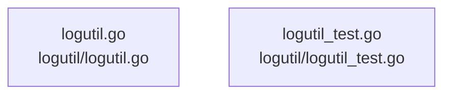

# overall-architecture/group-3/n-logutil-41f4e6

[解析トップへ戻る](../../../README.md)

確認したパス: `logutil`。配下の登録ファイルは2件。

- `logutil/logutil.go`（一覧のみ）
- `logutil/logutil_test.go`（一覧のみ）

## 要素の説明

### n-logutil-logutil-go-28d79f

実在パス: `logutil/logutil.go`。1ファイル。

- `logutil/logutil.go`

### n-logutil-logutil-test-go-19b0a2

実在パス: `logutil/logutil_test.go`。1ファイル。

- `logutil/logutil_test.go`

