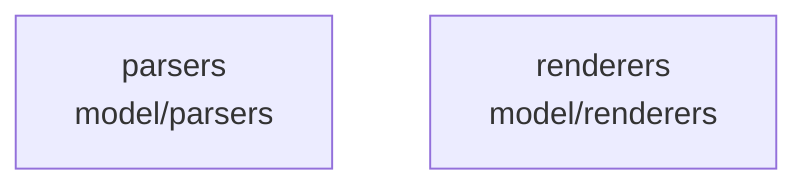

# overall-architecture/group-3/n-model-1d06a0

[解析トップへ戻る](../../../README.md)

確認したパス: `model`。配下の登録ファイルは100件。

- `model/parsers/cogito.go`（一覧のみ）
- `model/parsers/cogito_test.go`（一覧のみ）
- `model/parsers/cohere.go`（一覧のみ）
- `model/parsers/cohere_test.go`（一覧のみ）
- `model/parsers/deepseek3.go`（一覧のみ）
- `model/parsers/deepseek3_test.go`（一覧のみ）
- `model/parsers/functiongemma.go`（一覧のみ）
- `model/parsers/functiongemma_test.go`（一覧のみ）
- `model/parsers/gemma4.go`（一覧のみ）
- `model/parsers/gemma4_test.go`（一覧のみ）
- `model/parsers/glimmer.go`（一覧のみ）
- `model/parsers/glimmer_test.go`（一覧のみ）
- `model/parsers/glm46.go`（一覧のみ）
- `model/parsers/glm46_test.go`（一覧のみ）
- `model/parsers/glm47.go`（一覧のみ）
- `model/parsers/glm47_test.go`（一覧のみ）
- `model/parsers/glmocr.go`（一覧のみ）
- `model/parsers/laguna.go`（一覧のみ）
- `model/parsers/laguna_test.go`（一覧のみ）
- `model/parsers/lfm2.go`（一覧のみ）
- `model/parsers/lfm2_test.go`（一覧のみ）
- `model/parsers/ministral.go`（一覧のみ）
- `model/parsers/ministral_test.go`（一覧のみ）
- `model/parsers/nemotron3nano.go`（一覧のみ）
- `model/parsers/nemotron3nano_test.go`（一覧のみ）
- `model/parsers/olmo3.go`（一覧のみ）
- `model/parsers/olmo3_test.go`（一覧のみ）
- `model/parsers/olmo3_think.go`（一覧のみ）
- `model/parsers/olmo3_think_test.go`（一覧のみ）
- `model/parsers/parsers.go`（一覧のみ）
- `model/parsers/parsers_test.go`（一覧のみ）
- `model/parsers/qwen3.go`（一覧のみ）
- `model/parsers/qwen35.go`（一覧のみ）
- `model/parsers/qwen35_test.go`（一覧のみ）
- `model/parsers/qwen38_test.go`（一覧のみ）

## 要素の説明

### n-model-parsers-cb6735

実在パス: `model/parsers`。42ファイル。

- `model/parsers/cogito.go`
- `model/parsers/cogito_test.go`
- `model/parsers/cohere.go`
- `model/parsers/cohere_test.go`
- `model/parsers/deepseek3.go`
- `model/parsers/deepseek3_test.go`
- `model/parsers/functiongemma.go`
- `model/parsers/functiongemma_test.go`
- `model/parsers/gemma4.go`
- `model/parsers/gemma4_test.go`
- `model/parsers/glimmer.go`
- `model/parsers/glimmer_test.go`
- `model/parsers/glm46.go`
- `model/parsers/glm46_test.go`
- `model/parsers/glm47.go`
- `model/parsers/glm47_test.go`
- `model/parsers/glmocr.go`
- `model/parsers/laguna.go`
- `model/parsers/laguna_test.go`
- `model/parsers/lfm2.go`
- `model/parsers/lfm2_test.go`
- `model/parsers/ministral.go`
- `model/parsers/ministral_test.go`
- `model/parsers/nemotron3nano.go`
- `model/parsers/nemotron3nano_test.go`

### n-model-renderers-63f03f

実在パス: `model/renderers`。58ファイル。

- `model/renderers/cogito.go`
- `model/renderers/cogito_test.go`
- `model/renderers/cohere.go`
- `model/renderers/cohere_test.go`
- `model/renderers/deepseek3.go`
- `model/renderers/deepseek3_test.go`
- `model/renderers/functiongemma.go`
- `model/renderers/functiongemma_test.go`
- `model/renderers/gemma4.go`
- `model/renderers/gemma4_reference_test.go`
- `model/renderers/glimmer.go`
- `model/renderers/glimmer_reference_test.go`
- `model/renderers/glimmer_test.go`
- `model/renderers/glm46.go`
- `model/renderers/glm46_test.go`
- `model/renderers/glm47.go`
- `model/renderers/glm47_test.go`
- `model/renderers/glmocr.go`
- `model/renderers/glmocr_test.go`
- `model/renderers/image_tags.go`
- `model/renderers/image_tags_test.go`
- `model/renderers/json.go`
- `model/renderers/json_test.go`
- `model/renderers/laguna.go`
- `model/renderers/laguna_test.go`

