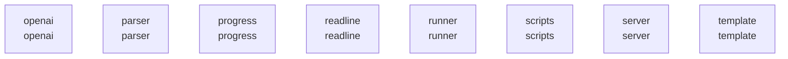

# overall-architecture/group-4

[解析トップへ戻る](../../README.md)

このグループは表示用の区切りです。独立した実行モジュールではありません。

## 要素の説明

### n-openai-7d3bbb

確認したパス: `openai`。配下の登録ファイルは8件。

- `openai/openai.go`（一覧のみ）
- `openai/openai_encoding_format_test.go`（一覧のみ）
- `openai/openai_test.go`（一覧のみ）
- `openai/responses.go`（一覧のみ）
- `openai/responses_compact.go`（一覧のみ）
- `openai/responses_compact_names_test.go`（一覧のみ）
- `openai/responses_compact_test.go`（一覧のみ）
- `openai/responses_test.go`（一覧のみ）

[詳細な図と説明を見る](n-openai-7d3bbb/README.md)

### n-parser-95324d

確認したパス: `parser`。配下の登録ファイルは3件。

- `parser/expandpath_test.go`（一覧のみ）
- `parser/parser.go`（一覧のみ）
- `parser/parser_test.go`（一覧のみ）

[詳細な図と説明を見る](n-parser-95324d/README.md)

### n-progress-5aaf89

確認したパス: `progress`。配下の登録ファイルは5件。

- `progress/bar.go`（一覧のみ）
- `progress/progress.go`（一覧のみ）
- `progress/progress_test.go`（一覧のみ）
- `progress/spinner.go`（一覧のみ）
- `progress/stepbar.go`（一覧のみ）

[詳細な図と説明を見る](n-progress-5aaf89/README.md)

### n-readline-2d9e02

確認したパス: `readline`。配下の登録ファイルは11件。

- `readline/buffer.go`（一覧のみ）
- `readline/errors.go`（一覧のみ）
- `readline/history.go`（一覧のみ）
- `readline/readline.go`（一覧のみ）
- `readline/readline_unix.go`（一覧のみ）
- `readline/readline_windows.go`（一覧のみ）
- `readline/term.go`（一覧のみ）
- `readline/term_bsd.go`（一覧のみ）
- `readline/term_linux.go`（一覧のみ）
- `readline/term_windows.go`（一覧のみ）
- `readline/types.go`（一覧のみ）

[詳細な図と説明を見る](n-readline-2d9e02/README.md)

### n-runner-63a5fd

確認したパス: `runner`。配下の登録ファイルは2件。

- `runner/README.md`（一覧のみ）
- `runner/runner.go`（一覧のみ）

### n-scripts-16728d

確認したパス: `scripts`。配下の登録ファイルは15件。

- `scripts/.this-is-the-create-dmg-repo`（一覧のみ）
- `scripts/build_darwin.sh`（一覧のみ）
- `scripts/build_docker.sh`（一覧のみ）
- `scripts/build_linux.sh`（一覧のみ）
- `scripts/build_windows.ps1`（一覧のみ）
- `scripts/buildkitd.toml.example`（一覧のみ）
- `scripts/create-dmg.sh`（一覧のみ）
- `scripts/deduplicate_cuda_libs.sh`（一覧のみ）
- `scripts/env.sh`（一覧のみ）
- `scripts/install.ps1`（一覧のみ）
- `scripts/install.sh`（一覧のみ）
- `scripts/push_docker.sh`（一覧のみ）
- `scripts/support/eula-resources-template.xml`（一覧のみ）
- `scripts/support/template.applescript`（一覧のみ）
- `scripts/tag_latest.sh`（一覧のみ）

### n-server-3de4f9

確認したパス: `server`。配下の登録ファイルは58件。

- `server/auth.go`（一覧のみ）
- `server/auth_test.go`（一覧のみ）
- `server/cloud_proxy.go`（一覧のみ）
- `server/cloud_proxy_test.go`（一覧のみ）
- `server/codex_proxy.go`（一覧のみ）
- `server/codex_proxy_test.go`（一覧のみ）
- `server/create.go`（一覧のみ）
- `server/create_test.go`（一覧のみ）
- `server/download.go`（一覧のみ）
- `server/download_test.go`（一覧のみ）
- `server/fixblobs.go`（一覧のみ）
- `server/fixblobs_test.go`（一覧のみ）
- `server/gemma4_test.go`（一覧のみ）
- `server/gguf_metadata.go`（一覧のみ）
- `server/gguf_metadata_test.go`（一覧のみ）
- `server/glimmer_images_test.go`（一覧のみ）
- `server/images.go`（一覧のみ）
- `server/images_test.go`（一覧のみ）
- `server/inference_request_log.go`（一覧のみ）
- `server/logprob.go`（一覧のみ）
- `server/model.go`（一覧のみ）
- `server/model_caches.go`（一覧のみ）
- `server/model_list.go`（一覧のみ）
- `server/model_list_test.go`（一覧のみ）
- `server/model_recommendations.go`（一覧のみ）
- `server/model_recommendations_test.go`（一覧のみ）
- `server/model_resolver.go`（一覧のみ）
- `server/model_resolver_test.go`（一覧のみ）
- `server/model_show_cache.go`（一覧のみ）
- `server/model_show_cache_test.go`（一覧のみ）
- `server/prompt.go`（一覧のみ）
- `server/prompt_test.go`（一覧のみ）
- `server/quantization.go`（一覧のみ）
- `server/quantization_stub_test.go`（一覧のみ）
- `server/quantization_test.go`（一覧のみ）

[詳細な図と説明を見る](n-server-3de4f9/README.md)

### n-template-3226ec

確認したパス: `template`。配下の登録ファイルは104件。

- `template/alfred.gotmpl`（一覧のみ）
- `template/alfred.json`（一覧のみ）
- `template/alpaca.gotmpl`（一覧のみ）
- `template/alpaca.json`（一覧のみ）
- `template/chatml.gotmpl`（一覧のみ）
- `template/chatml.json`（一覧のみ）
- `template/chatqa.gotmpl`（一覧のみ）
- `template/chatqa.json`（一覧のみ）
- `template/codellama-70b-instruct.gotmpl`（一覧のみ）
- `template/codellama-70b-instruct.json`（一覧のみ）
- `template/command-r.gotmpl`（一覧のみ）
- `template/command-r.json`（一覧のみ）
- `template/falcon-instruct.gotmpl`（一覧のみ）
- `template/falcon-instruct.json`（一覧のみ）
- `template/gemma-instruct.gotmpl`（一覧のみ）
- `template/gemma-instruct.json`（一覧のみ）
- `template/gemma3-instruct.gotmpl`（一覧のみ）
- `template/gemma3-instruct.json`（一覧のみ）
- `template/granite-instruct.gotmpl`（一覧のみ）
- `template/granite-instruct.json`（一覧のみ）
- `template/index.json`（一覧のみ）
- `template/llama2-chat.gotmpl`（一覧のみ）
- `template/llama2-chat.json`（一覧のみ）
- `template/llama3-instruct.gotmpl`（一覧のみ）
- `template/llama3-instruct.json`（一覧のみ）
- `template/magicoder.gotmpl`（一覧のみ）
- `template/magicoder.json`（一覧のみ）
- `template/mistral-instruct.gotmpl`（一覧のみ）
- `template/mistral-instruct.json`（一覧のみ）
- `template/openchat.gotmpl`（一覧のみ）
- `template/openchat.json`（一覧のみ）
- `template/phi-3.gotmpl`（一覧のみ）
- `template/phi-3.json`（一覧のみ）
- `template/solar-instruct.gotmpl`（一覧のみ）
- `template/solar-instruct.json`（一覧のみ）

[詳細な図と説明を見る](n-template-3226ec/README.md)

