# overall-architecture/group-4/n-openai-7d3bbb

[解析トップへ戻る](../../../README.md)

確認したパス: `openai`。配下の登録ファイルは8件。

- `openai/openai.go`（一覧のみ）
- `openai/openai_encoding_format_test.go`（一覧のみ）
- `openai/openai_test.go`（一覧のみ）
- `openai/responses.go`（一覧のみ）
- `openai/responses_compact.go`（一覧のみ）
- `openai/responses_compact_names_test.go`（一覧のみ）
- `openai/responses_compact_test.go`（一覧のみ）
- `openai/responses_test.go`（一覧のみ）

```mermaid
graph TD
    n-openai-openai-go-91ed74["openai.go\nopenai/openai.go"]
    n-openai-openai-encoding-format-test-go-2c61f2["openai_encoding_format_test.go\nopenai/openai_encoding_format_test.go"]
    n-openai-openai-test-go-e17138["openai_test.go\nopenai/openai_test.go"]
    n-openai-responses-go-ee1cd9["responses.go\nopenai/responses.go"]
    n-openai-responses-compact-go-aab056["responses_compact.go\nopenai/responses_compact.go"]
    n-openai-responses-compact-names-test-go-05cd39["responses_compact_names_test.go\nopenai/responses_compact_names_test.go"]
    n-openai-responses-compact-test-go-f2ab4a["responses_compact_test.go\nopenai/responses_compact_test.go"]
    n-openai-responses-test-go-434979["responses_test.go\nopenai/responses_test.go"]
```

## 要素の説明

### n-openai-openai-encoding-format-test-go-2c61f2

実在パス: `openai/openai_encoding_format_test.go`。1ファイル。

- `openai/openai_encoding_format_test.go`

### n-openai-openai-go-91ed74

実在パス: `openai/openai.go`。1ファイル。

- `openai/openai.go`

### n-openai-openai-test-go-e17138

実在パス: `openai/openai_test.go`。1ファイル。

- `openai/openai_test.go`

### n-openai-responses-compact-go-aab056

実在パス: `openai/responses_compact.go`。1ファイル。

- `openai/responses_compact.go`

### n-openai-responses-compact-names-test-go-05cd39

実在パス: `openai/responses_compact_names_test.go`。1ファイル。

- `openai/responses_compact_names_test.go`

### n-openai-responses-compact-test-go-f2ab4a

実在パス: `openai/responses_compact_test.go`。1ファイル。

- `openai/responses_compact_test.go`

### n-openai-responses-go-ee1cd9

実在パス: `openai/responses.go`。1ファイル。

- `openai/responses.go`

### n-openai-responses-test-go-434979

実在パス: `openai/responses_test.go`。1ファイル。

- `openai/responses_test.go`

