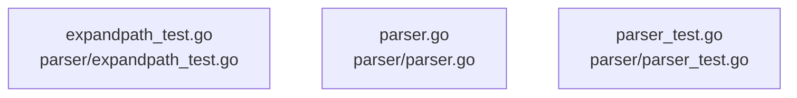

# overall-architecture/group-4/n-parser-95324d

[解析トップへ戻る](../../../README.md)

確認したパス: `parser`。配下の登録ファイルは3件。

- `parser/expandpath_test.go`（一覧のみ）
- `parser/parser.go`（一覧のみ）
- `parser/parser_test.go`（一覧のみ）

## 要素の説明

### n-parser-expandpath-test-go-fdce09

実在パス: `parser/expandpath_test.go`。1ファイル。

- `parser/expandpath_test.go`

### n-parser-parser-go-d85c93

実在パス: `parser/parser.go`。1ファイル。

- `parser/parser.go`

### n-parser-parser-test-go-02625e

実在パス: `parser/parser_test.go`。1ファイル。

- `parser/parser_test.go`

