# overall-architecture/group-4/n-readline-2d9e02

[解析トップへ戻る](../../../README.md)

確認したパス: `readline`。配下の登録ファイルは11件。

- `readline/buffer.go`（一覧のみ）
- `readline/errors.go`（一覧のみ）
- `readline/history.go`（一覧のみ）
- `readline/readline.go`（一覧のみ）
- `readline/readline_unix.go`（一覧のみ）
- `readline/readline_windows.go`（一覧のみ）
- `readline/term.go`（一覧のみ）
- `readline/term_bsd.go`（一覧のみ）
- `readline/term_linux.go`（一覧のみ）
- `readline/term_windows.go`（一覧のみ）
- `readline/types.go`（一覧のみ）

```mermaid
graph TD
    n-readline-buffer-go-3db0e3["buffer.go\nreadline/buffer.go"]
    n-readline-errors-go-f557b1["errors.go\nreadline/errors.go"]
    n-readline-history-go-ca7518["history.go\nreadline/history.go"]
    n-readline-readline-go-7a24d0["readline.go\nreadline/readline.go"]
    n-readline-readline-unix-go-e47d9e["readline_unix.go\nreadline/readline_unix.go"]
    n-readline-readline-windows-go-005025["readline_windows.go\nreadline/readline_windows.go"]
    n-readline-term-go-cb838c["term.go\nreadline/term.go"]
    n-readline-term-bsd-go-2d9d97["term_bsd.go\nreadline/term_bsd.go"]
```

## 要素の説明

### n-readline-buffer-go-3db0e3

実在パス: `readline/buffer.go`。1ファイル。

- `readline/buffer.go`

### n-readline-errors-go-f557b1

実在パス: `readline/errors.go`。1ファイル。

- `readline/errors.go`

### n-readline-history-go-ca7518

実在パス: `readline/history.go`。1ファイル。

- `readline/history.go`

### n-readline-readline-go-7a24d0

実在パス: `readline/readline.go`。1ファイル。

- `readline/readline.go`

### n-readline-readline-unix-go-e47d9e

実在パス: `readline/readline_unix.go`。1ファイル。

- `readline/readline_unix.go`

### n-readline-readline-windows-go-005025

実在パス: `readline/readline_windows.go`。1ファイル。

- `readline/readline_windows.go`

### n-readline-term-bsd-go-2d9d97

実在パス: `readline/term_bsd.go`。1ファイル。

- `readline/term_bsd.go`

### n-readline-term-go-cb838c

実在パス: `readline/term.go`。1ファイル。

- `readline/term.go`

