# overall-architecture/group-4/n-server-3de4f9

[解析トップへ戻る](../../../README.md)

確認したパス: `server`。配下の登録ファイルは58件。

- `server/auth.go`（一覧のみ）
- `server/auth_test.go`（一覧のみ）
- `server/cloud_proxy.go`（一覧のみ）
- `server/cloud_proxy_test.go`（一覧のみ）
- `server/codex_proxy.go`（一覧のみ）
- `server/codex_proxy_test.go`（一覧のみ）
- `server/create.go`（一覧のみ）
- `server/create_test.go`（一覧のみ）
- `server/download.go`（一覧のみ）
- `server/download_test.go`（一覧のみ）
- `server/fixblobs.go`（一覧のみ）
- `server/fixblobs_test.go`（一覧のみ）
- `server/gemma4_test.go`（一覧のみ）
- `server/gguf_metadata.go`（一覧のみ）
- `server/gguf_metadata_test.go`（一覧のみ）
- `server/glimmer_images_test.go`（一覧のみ）
- `server/images.go`（一覧のみ）
- `server/images_test.go`（一覧のみ）
- `server/inference_request_log.go`（一覧のみ）
- `server/logprob.go`（一覧のみ）
- `server/model.go`（一覧のみ）
- `server/model_caches.go`（一覧のみ）
- `server/model_list.go`（一覧のみ）
- `server/model_list_test.go`（一覧のみ）
- `server/model_recommendations.go`（一覧のみ）
- `server/model_recommendations_test.go`（一覧のみ）
- `server/model_resolver.go`（一覧のみ）
- `server/model_resolver_test.go`（一覧のみ）
- `server/model_show_cache.go`（一覧のみ）
- `server/model_show_cache_test.go`（一覧のみ）
- `server/prompt.go`（一覧のみ）
- `server/prompt_test.go`（一覧のみ）
- `server/quantization.go`（一覧のみ）
- `server/quantization_stub_test.go`（一覧のみ）
- `server/quantization_test.go`（一覧のみ）

```mermaid
graph TD
    n-server-auth-go-a0ab6a["auth.go\nserver/auth.go"]
    n-server-auth-test-go-3b8bae["auth_test.go\nserver/auth_test.go"]
    n-server-cloud-proxy-go-4b4370["cloud_proxy.go\nserver/cloud_proxy.go"]
    n-server-cloud-proxy-test-go-22e2bb["cloud_proxy_test.go\nserver/cloud_proxy_test.go"]
    n-server-codex-proxy-go-3472b2["codex_proxy.go\nserver/codex_proxy.go"]
    n-server-codex-proxy-test-go-c71134["codex_proxy_test.go\nserver/codex_proxy_test.go"]
    n-server-create-go-f0bdeb["create.go\nserver/create.go"]
    n-server-create-test-go-e23502["create_test.go\nserver/create_test.go"]
```

## 要素の説明

### n-server-auth-go-a0ab6a

実在パス: `server/auth.go`。1ファイル。

- `server/auth.go`

### n-server-auth-test-go-3b8bae

実在パス: `server/auth_test.go`。1ファイル。

- `server/auth_test.go`

### n-server-cloud-proxy-go-4b4370

実在パス: `server/cloud_proxy.go`。1ファイル。

- `server/cloud_proxy.go`

### n-server-cloud-proxy-test-go-22e2bb

実在パス: `server/cloud_proxy_test.go`。1ファイル。

- `server/cloud_proxy_test.go`

### n-server-codex-proxy-go-3472b2

実在パス: `server/codex_proxy.go`。1ファイル。

- `server/codex_proxy.go`

### n-server-codex-proxy-test-go-c71134

実在パス: `server/codex_proxy_test.go`。1ファイル。

- `server/codex_proxy_test.go`

### n-server-create-go-f0bdeb

実在パス: `server/create.go`。1ファイル。

- `server/create.go`

### n-server-create-test-go-e23502

実在パス: `server/create_test.go`。1ファイル。

- `server/create_test.go`

