# overall-architecture/group-4/n-template-3226ec/group-1

[解析トップへ戻る](../../../../README.md)

このグループは表示用の区切りです。独立した実行モジュールではありません。

```mermaid
graph TD
    n-template-testdata-5a9b1e["testdata\ntemplate/testdata"]
    n-template-alfred-json-712b6b["alfred.json\ntemplate/alfred.json"]
    n-template-alpaca-json-807a7e["alpaca.json\ntemplate/alpaca.json"]
    n-template-chatml-json-a1f5c4["chatml.json\ntemplate/chatml.json"]
    n-template-chatqa-json-a56c05["chatqa.json\ntemplate/chatqa.json"]
    n-template-codellama-70b-instruct-json-82d1cd["codellama-70b-instruct.json\ntemplate/codellama-70b-instruct.json"]
    n-template-command-r-json-8414ef["command-r.json\ntemplate/command-r.json"]
    n-template-falcon-instruct-json-49f653["falcon-instruct.json\ntemplate/falcon-instruct.json"]
```

## 要素の説明

### n-template-alfred-json-712b6b

実在パス: `template/alfred.json`。1ファイル。

- `template/alfred.json`

### n-template-alpaca-json-807a7e

実在パス: `template/alpaca.json`。1ファイル。

- `template/alpaca.json`

### n-template-chatml-json-a1f5c4

実在パス: `template/chatml.json`。1ファイル。

- `template/chatml.json`

### n-template-chatqa-json-a56c05

実在パス: `template/chatqa.json`。1ファイル。

- `template/chatqa.json`

### n-template-codellama-70b-instruct-json-82d1cd

実在パス: `template/codellama-70b-instruct.json`。1ファイル。

- `template/codellama-70b-instruct.json`

### n-template-command-r-json-8414ef

実在パス: `template/command-r.json`。1ファイル。

- `template/command-r.json`

### n-template-falcon-instruct-json-49f653

実在パス: `template/falcon-instruct.json`。1ファイル。

- `template/falcon-instruct.json`

### n-template-testdata-5a9b1e

実在パス: `template/testdata`。61ファイル。

- `template/testdata/alfred.gotmpl/system-user-assistant-user`
- `template/testdata/alfred.gotmpl/user`
- `template/testdata/alfred.gotmpl/user-assistant-user`
- `template/testdata/alpaca.gotmpl/system-user-assistant-user`
- `template/testdata/alpaca.gotmpl/user`
- `template/testdata/alpaca.gotmpl/user-assistant-user`
- `template/testdata/chatml.gotmpl/system-user-assistant-user`
- `template/testdata/chatml.gotmpl/user`
- `template/testdata/chatml.gotmpl/user-assistant-user`
- `template/testdata/chatqa.gotmpl/system-user-assistant-user`
- `template/testdata/chatqa.gotmpl/user`
- `template/testdata/chatqa.gotmpl/user-assistant-user`
- `template/testdata/codellama-70b-instruct.gotmpl/system-user-assistant-user`
- `template/testdata/codellama-70b-instruct.gotmpl/user`
- `template/testdata/codellama-70b-instruct.gotmpl/user-assistant-user`
- `template/testdata/command-r.gotmpl/system-user-assistant-user`
- `template/testdata/command-r.gotmpl/user`
- `template/testdata/command-r.gotmpl/user-assistant-user`
- `template/testdata/falcon-instruct.gotmpl/system-user-assistant-user`
- `template/testdata/falcon-instruct.gotmpl/user`
- `template/testdata/falcon-instruct.gotmpl/user-assistant-user`
- `template/testdata/gemma-instruct.gotmpl/system-user-assistant-user`
- `template/testdata/gemma-instruct.gotmpl/user`
- `template/testdata/gemma-instruct.gotmpl/user-assistant-user`
- `template/testdata/gemma3-instruct.gotmpl/system-user-assistant-user`

