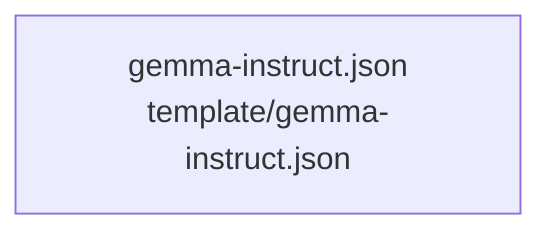

# overall-architecture/group-4/n-template-3226ec/group-2

[解析トップへ戻る](../../../../README.md)

このグループは表示用の区切りです。独立した実行モジュールではありません。

## 要素の説明

### n-template-gemma-instruct-json-8cf563

実在パス: `template/gemma-instruct.json`。1ファイル。

- `template/gemma-instruct.json`

