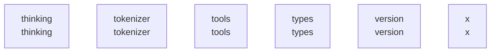

# overall-architecture/group-5

[解析トップへ戻る](../../README.md)

このグループは表示用の区切りです。独立した実行モジュールではありません。

## 要素の説明

### n-thinking-beac9e

確認したパス: `thinking`。配下の登録ファイルは4件。

- `thinking/parser.go`（一覧のみ）
- `thinking/parser_test.go`（一覧のみ）
- `thinking/template.go`（一覧のみ）
- `thinking/template_test.go`（一覧のみ）

[詳細な図と説明を見る](n-thinking-beac9e/README.md)

### n-tokenizer-12331f

確認したパス: `tokenizer`。配下の登録ファイルは13件。

- `tokenizer/bytepairencoding.go`（一覧のみ）
- `tokenizer/bytepairencoding_test.go`（一覧のみ）
- `tokenizer/sentencepiece.go`（一覧のみ）
- `tokenizer/sentencepiece_test.go`（一覧のみ）
- `tokenizer/testdata/gemma2/tokenizer.model`（一覧のみ）
- `tokenizer/testdata/llama3.2/encoder.json`（一覧のみ）
- `tokenizer/testdata/llama3.2/vocab.bpe`（一覧のみ）
- `tokenizer/testdata/war-and-peace.txt`（一覧のみ）
- `tokenizer/tokenizer.go`（一覧のみ）
- `tokenizer/vocabulary.go`（一覧のみ）
- `tokenizer/vocabulary_test.go`（一覧のみ）
- `tokenizer/wordpiece.go`（一覧のみ）
- `tokenizer/wordpiece_test.go`（一覧のみ）

[詳細な図と説明を見る](n-tokenizer-12331f/README.md)

### n-tools-0284c6

確認したパス: `tools`。配下の登録ファイルは4件。

- `tools/template.go`（一覧のみ）
- `tools/template_test.go`（一覧のみ）
- `tools/tools.go`（一覧のみ）
- `tools/tools_test.go`（一覧のみ）

[詳細な図と説明を見る](n-tools-0284c6/README.md)

### n-types-e7b1ff

確認したパス: `types`。配下の登録ファイルは9件。

- `types/errtypes/errtypes.go`（一覧のみ）
- `types/model/capability.go`（一覧のみ）
- `types/model/config.go`（一覧のみ）
- `types/model/generation.go`（一覧のみ）
- `types/model/generation_test.go`（一覧のみ）
- `types/model/name.go`（一覧のみ）
- `types/model/name_test.go`（一覧のみ）
- `types/model/testdata/fuzz/FuzzName/d37463aa416f6bab`（一覧のみ）
- `types/syncmap/syncmap.go`（一覧のみ）

[詳細な図と説明を見る](n-types-e7b1ff/README.md)

### n-version-c69227

確認したパス: `version`。配下の登録ファイルは1件。

- `version/version.go`（一覧のみ）

### n-x-11f6ad

確認したパス: `x`。配下の登録ファイルは261件。

- `x/create/blockfp8.go`（一覧のみ）
- `x/create/blockfp8_test.go`（一覧のみ）
- `x/create/classify.go`（一覧のみ）
- `x/create/classify_test.go`（一覧のみ）
- `x/create/client/create.go`（一覧のみ）
- `x/create/client/create_test.go`（一覧のみ）
- `x/create/cohere2moe.go`（一覧のみ）
- `x/create/create.go`（一覧のみ）
- `x/create/create_test.go`（一覧のみ）
- `x/create/draft.go`（一覧のみ）
- `x/create/draft_test.go`（一覧のみ）
- `x/create/dtype.go`（一覧のみ）
- `x/create/gemma4.go`（一覧のみ）
- `x/create/gemma4_test.go`（一覧のみ）
- `x/create/glimmer.go`（一覧のみ）
- `x/create/glimmer_test.go`（一覧のみ）
- `x/create/inventory.go`（一覧のみ）
- `x/create/inventory_test.go`（一覧のみ）
- `x/create/laguna.go`（一覧のみ）
- `x/create/laguna_test.go`（一覧のみ）
- `x/create/mlxthread.go`（一覧のみ）
- `x/create/nemotron_h.go`（一覧のみ）
- `x/create/nemotron_h_test.go`（一覧のみ）
- `x/create/pipeline.go`（一覧のみ）
- `x/create/pipeline_test.go`（一覧のみ）
- `x/create/plan.go`（一覧のみ）
- `x/create/plan_test.go`（一覧のみ）
- `x/create/prequant.go`（一覧のみ）
- `x/create/prequant_test.go`（一覧のみ）
- `x/create/quantize.go`（一覧のみ）
- `x/create/quantpolicy.go`（一覧のみ）
- `x/create/qwen35.go`（一覧のみ）
- `x/create/qwen4_exp.go`（一覧のみ）
- `x/create/qwen4_exp_test.go`（一覧のみ）
- `x/create/transform.go`（一覧のみ）

[詳細な図と説明を見る](n-x-11f6ad/README.md)

