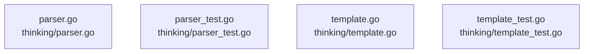

# overall-architecture/group-5/n-thinking-beac9e

[解析トップへ戻る](../../../README.md)

確認したパス: `thinking`。配下の登録ファイルは4件。

- `thinking/parser.go`（一覧のみ）
- `thinking/parser_test.go`（一覧のみ）
- `thinking/template.go`（一覧のみ）
- `thinking/template_test.go`（一覧のみ）

## 要素の説明

### n-thinking-parser-go-3bc696

実在パス: `thinking/parser.go`。1ファイル。

- `thinking/parser.go`

### n-thinking-parser-test-go-9d0a16

実在パス: `thinking/parser_test.go`。1ファイル。

- `thinking/parser_test.go`

### n-thinking-template-go-a8f8e4

実在パス: `thinking/template.go`。1ファイル。

- `thinking/template.go`

### n-thinking-template-test-go-ca6299

実在パス: `thinking/template_test.go`。1ファイル。

- `thinking/template_test.go`

