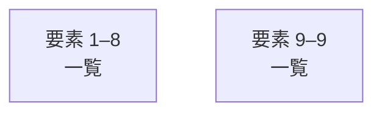

# overall-architecture/group-5/n-tokenizer-12331f

[解析トップへ戻る](../../../README.md)

確認したパス: `tokenizer`。配下の登録ファイルは13件。

- `tokenizer/bytepairencoding.go`（一覧のみ）
- `tokenizer/bytepairencoding_test.go`（一覧のみ）
- `tokenizer/sentencepiece.go`（一覧のみ）
- `tokenizer/sentencepiece_test.go`（一覧のみ）
- `tokenizer/testdata/gemma2/tokenizer.model`（一覧のみ）
- `tokenizer/testdata/llama3.2/encoder.json`（一覧のみ）
- `tokenizer/testdata/llama3.2/vocab.bpe`（一覧のみ）
- `tokenizer/testdata/war-and-peace.txt`（一覧のみ）
- `tokenizer/tokenizer.go`（一覧のみ）
- `tokenizer/vocabulary.go`（一覧のみ）
- `tokenizer/vocabulary_test.go`（一覧のみ）
- `tokenizer/wordpiece.go`（一覧のみ）
- `tokenizer/wordpiece_test.go`（一覧のみ）

## 要素の説明

### group-1

このグループは表示用の区切りです。独立した実行モジュールではありません。

[詳細な図と説明を見る](group-1/README.md)

### group-2

このグループは表示用の区切りです。独立した実行モジュールではありません。

[詳細な図と説明を見る](group-2/README.md)

