# overall-architecture/group-5/n-tokenizer-12331f/group-1

[解析トップへ戻る](../../../../README.md)

このグループは表示用の区切りです。独立した実行モジュールではありません。

```mermaid
graph TD
    n-tokenizer-testdata-bf76e3["testdata\ntokenizer/testdata"]
    n-tokenizer-bytepairencoding-go-5a81f7["bytepairencoding.go\ntokenizer/bytepairencoding.go"]
    n-tokenizer-bytepairencoding-test-go-498acb["bytepairencoding_test.go\ntokenizer/bytepairencoding_test.go"]
    n-tokenizer-sentencepiece-go-0f1898["sentencepiece.go\ntokenizer/sentencepiece.go"]
    n-tokenizer-sentencepiece-test-go-f9efa6["sentencepiece_test.go\ntokenizer/sentencepiece_test.go"]
    n-tokenizer-tokenizer-go-2d8e59["tokenizer.go\ntokenizer/tokenizer.go"]
    n-tokenizer-vocabulary-go-e5fa15["vocabulary.go\ntokenizer/vocabulary.go"]
    n-tokenizer-vocabulary-test-go-7f948c["vocabulary_test.go\ntokenizer/vocabulary_test.go"]
```

## 要素の説明

### n-tokenizer-bytepairencoding-go-5a81f7

実在パス: `tokenizer/bytepairencoding.go`。1ファイル。

- `tokenizer/bytepairencoding.go`

### n-tokenizer-bytepairencoding-test-go-498acb

実在パス: `tokenizer/bytepairencoding_test.go`。1ファイル。

- `tokenizer/bytepairencoding_test.go`

### n-tokenizer-sentencepiece-go-0f1898

実在パス: `tokenizer/sentencepiece.go`。1ファイル。

- `tokenizer/sentencepiece.go`

### n-tokenizer-sentencepiece-test-go-f9efa6

実在パス: `tokenizer/sentencepiece_test.go`。1ファイル。

- `tokenizer/sentencepiece_test.go`

### n-tokenizer-testdata-bf76e3

実在パス: `tokenizer/testdata`。4ファイル。

- `tokenizer/testdata/gemma2/tokenizer.model`
- `tokenizer/testdata/llama3.2/encoder.json`
- `tokenizer/testdata/llama3.2/vocab.bpe`
- `tokenizer/testdata/war-and-peace.txt`

### n-tokenizer-tokenizer-go-2d8e59

実在パス: `tokenizer/tokenizer.go`。1ファイル。

- `tokenizer/tokenizer.go`

### n-tokenizer-vocabulary-go-e5fa15

実在パス: `tokenizer/vocabulary.go`。1ファイル。

- `tokenizer/vocabulary.go`

### n-tokenizer-vocabulary-test-go-7f948c

実在パス: `tokenizer/vocabulary_test.go`。1ファイル。

- `tokenizer/vocabulary_test.go`

