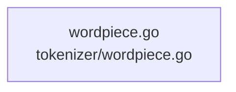

# overall-architecture/group-5/n-tokenizer-12331f/group-2

[解析トップへ戻る](../../../../README.md)

このグループは表示用の区切りです。独立した実行モジュールではありません。

## 要素の説明

### n-tokenizer-wordpiece-go-77bd63

実在パス: `tokenizer/wordpiece.go`。1ファイル。

- `tokenizer/wordpiece.go`

