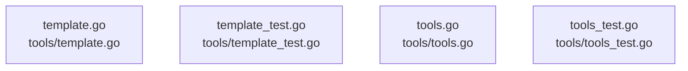

# overall-architecture/group-5/n-tools-0284c6

[解析トップへ戻る](../../../README.md)

確認したパス: `tools`。配下の登録ファイルは4件。

- `tools/template.go`（一覧のみ）
- `tools/template_test.go`（一覧のみ）
- `tools/tools.go`（一覧のみ）
- `tools/tools_test.go`（一覧のみ）

## 要素の説明

### n-tools-template-go-88b2a0

実在パス: `tools/template.go`。1ファイル。

- `tools/template.go`

### n-tools-template-test-go-799dd3

実在パス: `tools/template_test.go`。1ファイル。

- `tools/template_test.go`

### n-tools-tools-go-683390

実在パス: `tools/tools.go`。1ファイル。

- `tools/tools.go`

### n-tools-tools-test-go-a9e6c3

実在パス: `tools/tools_test.go`。1ファイル。

- `tools/tools_test.go`

