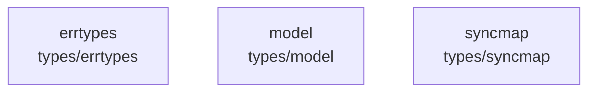

# overall-architecture/group-5/n-types-e7b1ff

[解析トップへ戻る](../../../README.md)

確認したパス: `types`。配下の登録ファイルは9件。

- `types/errtypes/errtypes.go`（一覧のみ）
- `types/model/capability.go`（一覧のみ）
- `types/model/config.go`（一覧のみ）
- `types/model/generation.go`（一覧のみ）
- `types/model/generation_test.go`（一覧のみ）
- `types/model/name.go`（一覧のみ）
- `types/model/name_test.go`（一覧のみ）
- `types/model/testdata/fuzz/FuzzName/d37463aa416f6bab`（一覧のみ）
- `types/syncmap/syncmap.go`（一覧のみ）

## 要素の説明

### n-types-errtypes-e298b4

実在パス: `types/errtypes`。1ファイル。

- `types/errtypes/errtypes.go`

### n-types-model-760c77

実在パス: `types/model`。7ファイル。

- `types/model/capability.go`
- `types/model/config.go`
- `types/model/generation.go`
- `types/model/generation_test.go`
- `types/model/name.go`
- `types/model/name_test.go`
- `types/model/testdata/fuzz/FuzzName/d37463aa416f6bab`

### n-types-syncmap-1db96b

実在パス: `types/syncmap`。1ファイル。

- `types/syncmap/syncmap.go`

