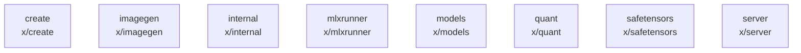

# overall-architecture/group-5/n-x-11f6ad/group-1

[解析トップへ戻る](../../../../README.md)

このグループは表示用の区切りです。独立した実行モジュールではありません。

## 要素の説明

### n-x-create-b80712

実在パス: `x/create`。37ファイル。

- `x/create/blockfp8.go`
- `x/create/blockfp8_test.go`
- `x/create/classify.go`
- `x/create/classify_test.go`
- `x/create/client/create.go`
- `x/create/client/create_test.go`
- `x/create/cohere2moe.go`
- `x/create/create.go`
- `x/create/create_test.go`
- `x/create/draft.go`
- `x/create/draft_test.go`
- `x/create/dtype.go`
- `x/create/gemma4.go`
- `x/create/gemma4_test.go`
- `x/create/glimmer.go`
- `x/create/glimmer_test.go`
- `x/create/inventory.go`
- `x/create/inventory_test.go`
- `x/create/laguna.go`
- `x/create/laguna_test.go`
- `x/create/mlxthread.go`
- `x/create/nemotron_h.go`
- `x/create/nemotron_h_test.go`
- `x/create/pipeline.go`
- `x/create/pipeline_test.go`

### n-x-imagegen-860a17

実在パス: `x/imagegen`。2ファイル。

- `x/imagegen/manifest/manifest.go`
- `x/imagegen/manifest/manifest_test.go`

### n-x-internal-d6d4ac

実在パス: `x/internal`。12ファイル。

- `x/internal/mlxtest/mlxtest.go`
- `x/internal/mlxthread/thread.go`
- `x/internal/mlxthread/thread_affinity_test.go`
- `x/internal/mlxthread/thread_test.go`
- `x/internal/mlxthread/threadid_darwin_test.go`
- `x/internal/mlxthread/threadid_linux_test.go`
- `x/internal/mlxthreadtest/mlxthreadtest.go`
- `x/internal/mlxthreadtest/mlxthreadtest_test.go`
- `x/internal/mlxthreadtest/threadid_darwin.go`
- `x/internal/mlxthreadtest/threadid_linux.go`
- `x/internal/mlxthreadtest/threadid_other.go`
- `x/internal/mlxthreadtest/threadid_windows.go`

### n-x-mlxrunner-b8f1b4

実在パス: `x/mlxrunner`。130ファイル。

- `x/mlxrunner/batch/batch.go`
- `x/mlxrunner/cache/cache.go`
- `x/mlxrunner/cache/cache_test.go`
- `x/mlxrunner/cache/kvcache.go`
- `x/mlxrunner/cache/lazy_test.go`
- `x/mlxrunner/cache/recurrent.go`
- `x/mlxrunner/cache/recurrent_test.go`
- `x/mlxrunner/cache/rotating.go`
- `x/mlxrunner/cache/rotating_attention_test.go`
- `x/mlxrunner/cache/rotating_multiturn_test.go`
- `x/mlxrunner/cache/snapshot_capture_test.go`
- `x/mlxrunner/cache_trie.go`
- `x/mlxrunner/cache_trie_test.go`
- `x/mlxrunner/client.go`
- `x/mlxrunner/client_test.go`
- `x/mlxrunner/dflash.go`
- `x/mlxrunner/dflash_test.go`
- `x/mlxrunner/grammar.go`
- `x/mlxrunner/grammar_mask_test.go`
- `x/mlxrunner/grammar_test.go`
- `x/mlxrunner/imports.go`
- `x/mlxrunner/media.go`
- `x/mlxrunner/media_test.go`
- `x/mlxrunner/mlx/.gitignore`
- `x/mlxrunner/mlx/CMakeLists.txt`

### n-x-models-2d61b7

実在パス: `x/models`。58ファイル。

- `x/models/cohere2_moe/cohere2_moe.go`
- `x/models/dflash/dflash.go`
- `x/models/gemma4/assistant.go`
- `x/models/gemma4/audio.go`
- `x/models/gemma4/audio_test.go`
- `x/models/gemma4/gemma4.go`
- `x/models/gemma4/gemma4_moe_test.go`
- `x/models/gemma4/gemma4_test.go`
- `x/models/gemma4/media.go`
- `x/models/gemma4/media_test.go`
- `x/models/gemma4/process_audio.go`
- `x/models/gemma4/process_audio_test.go`
- `x/models/gemma4/process_image.go`
- `x/models/gemma4/vision.go`
- `x/models/gemma4/vision_test.go`
- `x/models/glimmer/glimmer.go`
- `x/models/glimmer/glimmer_test.go`
- `x/models/glimmer/media.go`
- `x/models/glimmer/media_test.go`
- `x/models/glimmer/vision.go`
- `x/models/glm4_moe_lite/glm4_moe_lite.go`
- `x/models/glm4_moe_lite/parser.go`
- `x/models/glm4_moe_lite/parser_test.go`
- `x/models/glm4_moe_lite/render.go`
- `x/models/glm4_moe_lite/render_test.go`

### n-x-quant-979156

実在パス: `x/quant`。2ファイル。

- `x/quant/quant.go`
- `x/quant/quant_test.go`

### n-x-safetensors-bc352c

実在パス: `x/safetensors`。2ファイル。

- `x/safetensors/extractor.go`
- `x/safetensors/extractor_test.go`

### n-x-server-9a14bf

実在パス: `x/server`。2ファイル。

- `x/server/show.go`
- `x/server/show_test.go`

