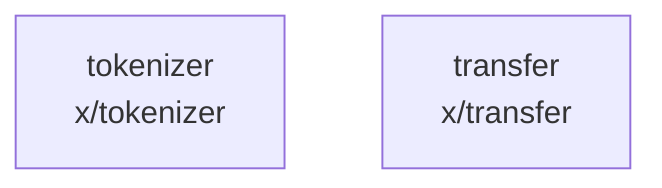

# overall-architecture/group-5/n-x-11f6ad/group-2

[解析トップへ戻る](../../../../README.md)

このグループは表示用の区切りです。独立した実行モジュールではありません。

## 要素の説明

### n-x-tokenizer-517745

実在パス: `x/tokenizer`。10ファイル。

- `x/tokenizer/testdata/mini_llama.json`
- `x/tokenizer/tokenizer.go`
- `x/tokenizer/tokenizer_benchmark_test.go`
- `x/tokenizer/tokenizer_bpe.go`
- `x/tokenizer/tokenizer_correctness_test.go`
- `x/tokenizer/tokenizer_decode.go`
- `x/tokenizer/tokenizer_encode.go`
- `x/tokenizer/tokenizer_ggml_parity_test.go`
- `x/tokenizer/tokenizer_load.go`
- `x/tokenizer/tokenizer_load_test.go`

### n-x-transfer-53f4c2

実在パス: `x/transfer`。6ファイル。

- `x/transfer/download.go`
- `x/transfer/sparse_other.go`
- `x/transfer/sparse_windows.go`
- `x/transfer/transfer.go`
- `x/transfer/transfer_test.go`
- `x/transfer/upload.go`

